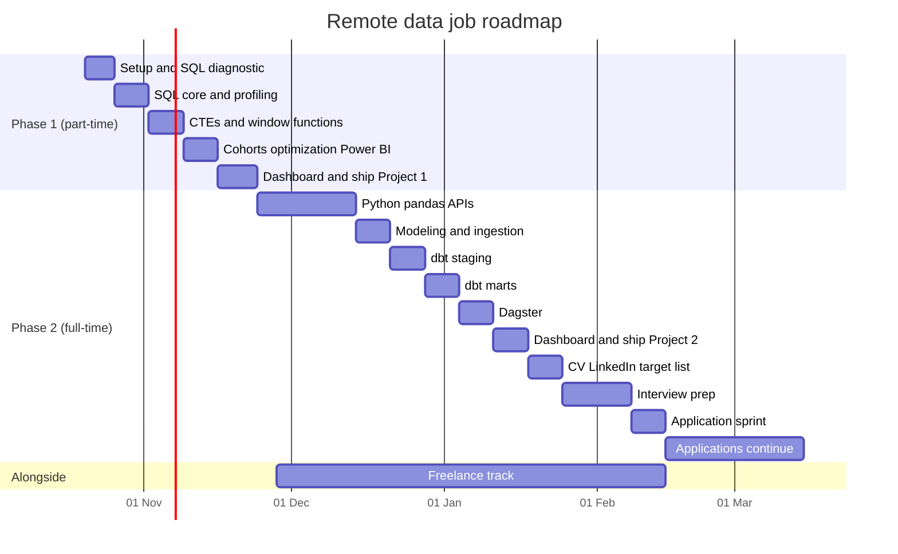
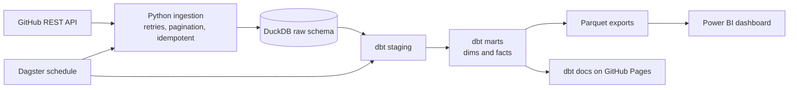

# Data_Engineering

# From Zero to First Remote Data Job

> **Goal:** first job as an **Analytics Engineer** (remote/international; on-site only inside Bangladesh). Long-term: **Data Engineer**.
> **Budget:** free only. No paid courses, certificates, cloud billing, or credit cards.
> **Start:** Tue 20 Oct 2026 · **Phase 1 (part-time):** 20 Oct → 23 Nov · **Phase 2 (full-time, 12 weeks):** 24 Nov → 14 Feb 2027 · **Applications:** soft start in Phase 2 Week 6, full sprint in Weeks 10–12, then continue until you have an offer.

---

## Table of Contents

1. [TL;DR](#tldr)
2. [How to use this roadmap](#how-to-use-this-roadmap)
3. [Reality check: remote entry-level hiring](#reality-check-remote-entry-level-hiring)
4. [Your stack: use these, skip those](#your-stack-use-these-skip-those)
5. [Timeline and progress tracker](#timeline-and-progress-tracker)
6. [Phase 1: SQL and Project 1](#phase-1-sql-and-project-1)
   - [SQL diagnostic test](#sql-diagnostic-test)
   - [P1 Week 1: Setup, Data Load, SQL Diagnostic](#p1-week-1-setup-data-load-sql-diagnostic)
   - [P1 Week 2: SQL Core and Data Profiling](#p1-week-2-sql-core-and-data-profiling)
   - [P1 Week 3: CTEs, Subqueries, Window Functions](#p1-week-3-ctes-subqueries-window-functions)
   - [P1 Week 4: Cohorts, Optimization, KPI Views](#p1-week-4-cohorts-optimization-kpi-views)
   - [P1 Week 5: Dashboard, Insights, Ship](#p1-week-5-dashboard-insights-ship)
   - [Project 1 spec and definition of done](#project-1-spec-and-definition-of-done)
   - [Git and GitHub minimum](#git-and-github-the-minimum-you-must-know-built-into-the-weeks-above)
7. [Phase 2: Analytics Engineering Stack and Project 2](#phase-2-analytics-engineering-stack-and-project-2)
   - [P2 Week 1: Python Foundations by Building](#p2-week-1-python-foundations-by-building)
   - [P2 Week 2: pandas and the Parity Check](#p2-week-2-pandas-and-the-parity-check)
   - [P2 Week 3: APIs and the Raw Layer](#p2-week-3-apis-and-the-raw-layer)
   - [P2 Week 4: Modeling Theory and Ingestion Hardening](#p2-week-4-modeling-theory-and-ingestion-hardening)
   - [P2 Week 5: dbt Setup and Staging Layer](#p2-week-5-dbt-setup-and-staging-layer)
   - [P2 Week 6: dbt Marts, Incremental, Snapshots](#p2-week-6-dbt-marts-incremental-snapshots)
   - [P2 Week 7: Orchestration with Dagster](#p2-week-7-orchestration-with-dagster)
   - [P2 Week 8: Dashboard, Docs Site, Ship Project 2](#p2-week-8-dashboard-docs-site-ship-project-2)
   - [P2 Week 9: CV, LinkedIn, GitHub, Target List](#p2-week-9-cv-linkedin-github-target-list)
   - [P2 Week 10: SQL Interview Prep](#p2-week-10-sql-interview-prep)
   - [P2 Week 11: Modeling, dbt, Behavioral Prep](#p2-week-11-modeling-dbt-behavioral-prep)
   - [P2 Week 12: Application Sprint](#p2-week-12-application-sprint)
   - [After week 12](#after-week-12)
   - [Project 2 spec and definition of done](#project-2-spec-and-definition-of-done)
8. [Freelance track](#freelance-track)
9. [Application engine](#application-engine)
10. [Remote work: async habits and time zones](#remote-work-async-habits-and-time-zones)
11. [Interview prep banks](#interview-prep-banks)
12. [Weekly reflection template](#weekly-reflection-template)
13. [Appendices](#appendices)

---

## TL;DR

| Phase | Dates | What you ship |
|---|---|---|
| **P1** (part-time, ~14 h/week) | 20 Oct → 23 Nov | SQL diagnostic + retest, **Project 1** (Olist SQL analysis + Power BI dashboard + written insights), a Git/GitHub habit |
| **P2 Wk 1–3** (full-time) | 24 Nov → 13 Dec | Python, pandas, API ingestion scripts with tests |
| **P2 Wk 4–6** | 14 Dec → 3 Jan | Star-schema design, DuckDB warehouse, dbt Core staging + marts + tests + docs + snapshot |
| **P2 Wk 7** | 4 → 10 Jan | Dagster pipeline on a daily schedule |
| **P2 Wk 8** | 11 → 17 Jan | **Project 2** shipped: dashboard + live dbt docs site |
| **P2 Wk 9–12** | 18 Jan → 14 Feb | CV, LinkedIn, GitHub polish, interview prep, application sprint |
| **Alongside** | from 28 Nov | Freelance track (about 3 h/week, rising to 6 h/week) |

**Three rules that matter more than any tool:**
1. **Ship small, ship often.** Every week ends with something committed to GitHub.
2. **Apply while you learn.** Waiting until you feel ready is the most common failure mode.
3. **Process goals, not outcome goals.** You control hours, commits, projects, applications, and conversations. You do not control who replies.

---

## How to use this roadmap

### 1. Set up your "control center" (Day 1, 10 minutes)
- Create a **private** GitHub repo called `career-roadmap`.
- Save this file as `README.md` in it. Everything you tick, note, and reflect on lives here. Your commit history becomes proof of consistency.

### 2. Tick boxes by editing the file
Checkboxes look like this: `- [ ] (45m) Do the thing`.

- To tick one, change `[ ]` to `[x]`, then commit (for example: `tick: P1 W1 Tue`).
- On GitHub, checkboxes in a *rendered* README file are **read-only**. Use the pencil icon (Edit this file) on GitHub, or edit locally in VS Code, then commit.
- Times in parentheses are **estimates**: `(45m)`, `(2h)`. If a task runs to double its estimate, apply the stuck rule below.

Quick progress counter (PowerShell, run in the repo folder):
```powershell
$done  = (Select-String -Path .\README.md -Pattern '^\s*- \[x\]').Count
$total = $done + (Select-String -Path .\README.md -Pattern '^\s*- \[ \]').Count
"$done / $total tasks done"
```
(In Phase 2 Week 1 you will replace this with your own Python script. That is Build 1.)

### 3. Daily rhythm
1. Open README → find today's block.
2. Do the tasks → tick them → commit your work (SQL, scripts, notes).
3. Write 3 lines in a `notes/` folder: *what I did, what confused me, what's next.*

**Minimum viable day** (when life happens): 45 minutes = 3 SQL problems + 1 commit. Never zero.

### 4. Weekly ritual (Sunday, 20–30 minutes)
- [ ] Update the [progress tracker](#timeline-and-progress-tracker).
- [ ] Check the week's **Definition of Done (DoD)**.
- [ ] Fill in the [weekly reflection](#weekly-reflection-template).
- [ ] Look at the **Gate** (if any) and apply the *cut list* if you are behind.

### 5. Rules of engagement
- **Do first, read second.** Try the task for 15–20 minutes before opening a tutorial or asking for help.
- **The 30-minute stuck rule.** Stuck for 30 minutes → write down exactly what you tried → ask (community forum, a friend, or an AI tutor) → move on to the next task and come back.
- **Using an AI assistant:** attempt first, then ask for *hints*, not solutions. Paste your query + the error. After you solve it, ask for a review and trade-offs. Never commit code you cannot explain line by line. Interviewers test live, and you must be able to defend every line in your portfolio.
- **Rest is part of the plan.** One full day off per week in Phase 2. Sleep. Stable routine. Burnout is the real schedule risk.
- **No new tools.** If it is not in the [stack table](#your-stack-use-these-skip-those), it waits.

### 6. Legend
| Marker | Meaning |
|---|---|
| `(45m)`, `(2h)` | Time estimate |
| **Track A / B / C** | Adapted path after your SQL diagnostic |
| `(stretch)` | Do only if you are ahead of schedule |
| **Gate** | Checkpoint: decide to continue or cut scope |
| **DoD** | Definition of done: a week or project is not finished until all boxes are ticked |
| Collapsible `▶` sections | Resources and hints. Open only when you need them |

### 7. If you fall behind: the cut list
Do **not** extend deadlines silently. Cut in this order:

**Phase 1:** Power BI page 3 → optimization lab 2 → peer review (RFM is already a stretch item). *(Never cut: diagnostic, profiling, window functions, README.)*
**Phase 2:** CI → extra repos in the pipeline → Dagster backfill/partitions → dashboard page 2 → blog post. *(Never cut: dbt tests + docs, README, SQL practice, applications.)*

---

## Reality check: remote entry-level hiring

You asked for honesty, so here it is.

1. **Entry-level remote data jobs are among the hardest roles to land.** Many postings say "remote" but restrict by country, time zone, or legal entity. Analytics Engineer and Data Engineer ads often ask for 1–3 years of experience. Every open role attracts large numbers of applicants.
2. **You have real strengths:** a math background (statistics, logic, precision), SQL + Power BI + Excel foundations, strong English, and stable internet and power. You also have real gaps: no work history in data, no portfolio yet, and a non-CS degree that some automated screens may not match.
3. **What this means for strategy:**
   - Target a **wider set of titles** (see [Application engine](#application-engine)), not only "Analytics Engineer".
   - **Proof beats claims:** two finished, documented projects (SQL + BI, then pipeline + dbt) with live links.
   - Use **freelance/contract work** as a way in and as a source of references.
   - Use **community and referrals** (dbt Community, LinkedIn conversations, small startups), not only cold applications.
   - Keep a **Plan B for income:** on-site analyst/BI roles in Bangladesh and freelance gigs while you keep applying.
4. **Realistic expectation.** After Week 12 you should be a *credible junior candidate*. That is not a promise of a job by February. For cold remote applications from outside a company's usual hiring region, reply rates are often low, so plan for **months of searching** and **dozens to hundreds** of targeted applications. Some people get lucky sooner. Do not plan on luck.
5. **Scam radar (free-only means you are a target).** Walk away if anyone asks you to: pay for a job, training, or "equipment"; cash a cheque or receive money for them; move the interview to chat apps only; share ID or bank details before an offer. Verify the company's website domain, their LinkedIn page, and that the recruiter's email matches the company domain. Real employers never need your money.

---

## Your stack: use these, skip those

**Fewer tools, done well.** This is the entire stack.

| Layer | Use (all free) | Why this one | Skip for now |
|---|---|---|---|
| Editor | **VS Code** | SQL, Python, Markdown, Git in one place | PyCharm, JupyterLab, notebooks as default |
| Version control | **Git + GitHub** | Your portfolio lives here | GitLab, Bitbucket |
| SQL engine (Phase 1) | **PostgreSQL + pgAdmin** (local) | Real engine: `EXPLAIN`, indexes, and Power BI connects natively | MySQL/SQL Server/SQLite dialect hopping, Docker |
| BI | **Power BI Desktop** (Windows, free) | You already know it | Tableau, Looker Studio, advanced Excel |
| Language (Phase 2) | **Python 3.12** + `venv` + `pip` | Most compatible with dbt and Dagster | Conda, poetry, R |
| DataFrames | **pandas** | Industry default | polars, PySpark (later) |
| Warehouse (Phase 2) | **DuckDB** (single local file) | Zero admin, fast, works with dbt Core | Cloud warehouses (optional later: BigQuery sandbox) |
| Transformation | **dbt Core + dbt-duckdb** | The skill AE job ads name most | dbt Cloud features, SQLMesh |
| Orchestration | **Dagster** (open source) | Asset graph maps onto dbt; runs on Windows | Airflow (later), Prefect |
| CI (optional) | GitHub Actions | Shows engineering habits | Jenkins, anything self-hosted |
| Practice | DataLemur free tier, pgexercises, SQLBolt, free LeetCode/HackerRank SQL | Interview-style + fundamentals | Paid tiers |

> **Assumption:** your laptop runs Windows (Power BI Desktop is Windows-only, and the commands here are PowerShell). Everything else also works on macOS/Linux with minor command changes.

**Skip list (and why):**
- **Paid certificates and courses** (dbt certification exams, Power BI exam, bootcamps): the budget is zero and portfolio beats badges at your level.
- **Advanced Excel, Tableau, a second BI tool:** you need depth in SQL and modeling, not more dashboard tools.
- **Spark, Kafka, Kubernetes, Docker, cloud certifications:** Data Engineer topics for *after* the first job (see [After week 12](#after-week-12)).
- **Machine learning / Kaggle competitions:** a different career track.
- **LeetCode algorithm puzzles:** do SQL problems only.
- **Learning two of everything** (pandas *and* polars, Postgres *and* MySQL, Airflow *and* Dagster).
- **Tutorial binge-watching.** Every concept must end in a query, a script, or a commit.

> Link and tool status (what I checked on 20 Oct 2026, and what I did not) is in [Appendix E](#appendix-e-link-and-tool-status).

---

## Timeline and progress tracker



### Weekly tracker

Update every Sunday. "Boxes" = ticked / total for that week.

| Week | Dates | Focus | Plan h | Actual h | Boxes | DoD met? | Gate |
|---|---|---|---|---|---|---|---|
| P1 W1 | 20–25 Oct | Setup, data load, diagnostic | 13 | | __ / __ | ☐ | Track chosen: __ |
| P1 W2 | 26 Oct–1 Nov | SQL core, profiling | 14.5 | | __ / __ | ☐ | |
| P1 W3 | 2–8 Nov | CTEs, subqueries, windows | 14.5 | | __ / __ | ☐ | |
| P1 W4 | 9–15 Nov | Cohorts, optimization, views, BI start | 14.5 | | __ / __ | ☐ | |
| P1 W5 | 16–22 Nov | Dashboard, insights, ship | 14.5 | | __ / __ | ☐ | Project 1 shipped? ☐ |
| P1 wrap | Mon 23 Nov | Close-out | 1.5 | | __ / __ | ☐ | **Gate 1** |
| P2 W1 | 24–29 Nov | Python by building | 31.5 | | __ / __ | ☐ | |
| P2 W2 | 30 Nov–6 Dec | pandas, parity check | 38 | | __ / __ | ☐ | |
| P2 W3 | 7–13 Dec | APIs, raw layer | 38 | | __ / __ | ☐ | |
| P2 W4 | 14–20 Dec | Modeling, ingestion | 38 | | __ / __ | ☐ | |
| P2 W5 | 21–27 Dec | dbt setup, staging | 38 | | __ / __ | ☐ | |
| P2 W6 | 28 Dec–3 Jan | dbt marts, snapshots | 38 | | __ / __ | ☐ | **Gate 2** |
| P2 W7 | 4–10 Jan | Dagster | 38 | | __ / __ | ☐ | |
| P2 W8 | 11–17 Jan | Dashboard, docs, ship | 38 | | __ / __ | ☐ | Project 2 shipped? ☐ |
| P2 W9 | 18–24 Jan | CV, LinkedIn, target list | 38 | | __ / __ | ☐ | **Gate 3** |
| P2 W10 | 25–31 Jan | SQL interview prep | 38 | | __ / __ | ☐ | |
| P2 W11 | 1–7 Feb | Modeling/dbt/behavioral prep | 38 | | __ / __ | ☐ | |
| P2 W12 | 8–14 Feb | Application sprint | 38 | | __ / __ | ☐ | |

### Milestones

- [ ] SQL diagnostic completed and scored (target: Sat 24 Oct)
- [ ] Olist data loaded into PostgreSQL (target: Wed 21 Oct)
- [ ] **Project 1 shipped** (target: Sat 21 Nov)
- [ ] Python env + first 3 scripts with tests (target: Fri 27 Nov)
- [ ] GitHub API ingestion working (target: Fri 11 Dec)
- [ ] dbt `build` green on staging layer (target: Wed 23 Dec)
- [ ] dbt marts + tests + snapshot (target: Fri 1 Jan)
- [ ] Dagster daily schedule running (target: Thu 7 Jan)
- [ ] **Project 2 shipped** with live dbt docs (target: Thu 14 Jan)
- [ ] CV v1 (target: Sat 19 Dec) · CV v2 (target: Mon 18 Jan)
- [ ] LinkedIn + GitHub polished (target: Tue 19 Jan)
- [ ] First tailored application sent (target: Mon 28 Dec)
- [ ] First freelance proposal sent (target: Sat 12 Dec)
- [ ] First interview (date: ____) · First offer (date: ____)

### Application funnel (fill in weekly from Phase 2 Week 6)

| Week of | Applications | Outreach messages | Replies | Screens | Interviews | Offers | Freelance proposals | Freelance replies |
|---|---|---|---|---|---|---|---|---|
| | | | | | | | | |

---
## Phase 1: SQL and Project 1

**Dates:** Tue 20 Oct → Mon 23 Nov 2026 · **Pace:** 1–2 h on weekdays (plan uses 1.5 h), 3–4 h on weekends (plan uses 3.5 h) · **About 14 h/week.**

**The outcome:** you can write solid intermediate-to-advanced SQL, and you have **one finished project** on a real public dataset, with business questions, SQL analysis, a Power BI dashboard, written insights, and a clean GitHub README.

**Dataset:** the [Brazilian E-Commerce Public Dataset by Olist](https://www.kaggle.com/datasets/olistbr/brazilian-ecommerce) (about 100k orders, 2016–2018, 9 CSV tables). You need a free Kaggle account to download it. Check the license on the dataset page and credit Olist in your README.

### How every SQL concept gets applied immediately

| Concept | Where you use it (same week) |
|---|---|
| SELECT, WHERE, GROUP BY, HAVING | Data profiling of every table (W2) |
| JOINs, anti-joins, join fan-out | Reconciling orders ↔ items ↔ payments (W2) |
| NULLs, CASE, dates | Data-quality log, delivery-time metrics (W2–W3) |
| Subqueries (scalar, correlated, EXISTS) | "Customers whose latest order was cancelled" style questions (W3) |
| CTEs | Refactoring every analysis into readable steps (W3 onward) |
| Window functions | Revenue growth, top-N per group, running totals, cohorts (W3–W4) |
| Query optimization | `EXPLAIN ANALYZE` on your own slow queries, then indexes (W4) |
| Views and schemas | `analytics` views that feed Power BI (W4–W5) |

### Track system (adapts to your diagnostic)

Your SQL level is unknown, so **do the diagnostic first** (Days 3–5), then choose a track. Each week below is written for **Track B** and lists adaptations for A and C.

| Diagnostic score (out of 20) | Track | What changes |
|---|---|---|
| 0–7 | **A: Rebuild** | W2 is mainly fundamentals (SQLBolt + pgexercises basics). Profile only 4 core tables. Windows start in W3 as planned. Project 1 dashboard = 2 pages. |
| 7.5–13.5 | **B: Core** | Follow the plan as written. |
| 14–20 | **C: Accelerate** | Skip fundamentals practice. Use LeetCode/DataLemur medium problems. Pull window functions into W2. Add stretch topics (recursive CTE, `GROUPING SETS`). Spend freed time on the Kaggle Python course early (it will make Phase 2 faster). |

---

### SQL diagnostic test

**Rules**
- Run all queries on your local Olist database (loaded in Week 1).
- **No looking up solutions.** You may check syntax docs, but count each lookup.
- **Score:** 1 point = correct output, no solution lookup, within the time budget. 0.5 = correct with 1–2 syntax lookups or slightly over time, or partially correct. 0 = incomplete.
- **Tier budgets:** T1 = 20 min, T2 = 40 min, T3 = 60 min, T4 = 75 min.
- **Triangulate** at least 3 answers a second way (Excel pivot on the CSV, or a different SQL approach). Disagreement means a bug.
- Save every answer as `sql/diagnostic/qNN.sql` and commit.

**Tier 1: Fundamentals (20 min)**
1. How many orders exist? How many distinct customers by `customer_id` vs by `customer_unique_id`? Which identifies a *person*?
2. Orders per `order_status`, most common first.
3. The 10 most expensive order items (by `price`) with `order_id`, `product_id`, `seller_id`.
4. Orders per month in 2017, sorted by month.
5. Top 5 customer states by number of *distinct people*.

**Tier 2: Joins and aggregation (40 min)**
6. Top 10 **English** product categories by revenue (sum of `price`), with total freight. Show products with no category as `unknown`.
7. Delivered orders only: average delivery time in days (purchase → customer delivery) per customer state, only states with ≥ 500 delivered orders.
8. Of delivered orders, what % arrived after the estimated date? One row, one number.
9. Per `payment_type`: number of orders, total `payment_value`, average installments.
10. How many orders have **no review**? Solve it two different ways and confirm the answers match.

**Tier 3: CTEs, subqueries, windows (60 min)**
11. Monthly revenue (item `price`, delivered orders) with month-over-month % change, using a CTE and `LAG`.
12. Top 3 sellers by revenue within each seller state.
13. Cumulative (running) revenue by month, and each month's share of the grand total.
14. How many `customer_unique_id`s have more than one order, and what % of all unique customers is that?
15. Categories where average item price is more than 1.5× the **median** item price (hint: `PERCENTILE_CONT`).

**Tier 4: Advanced, data quality, performance (75 min)**
16. Find `review_id`s that appear more than once. Explain why that is a problem, then build a clean "one review per order" set (latest `review_answer_timestamp` wins) using `ROW_NUMBER`.
17. Of unique customers, how many placed a second order within 90 days of their first?
18. Seller scorecard: for sellers with ≥ 50 distinct orders, compute late-delivery rate and average review score. Flag sellers with average score < 3.5. **Beware fan-out:** `order_items` has several rows per order.
19. Take your slowest query so far. Run `EXPLAIN (ANALYZE, BUFFERS)`, add one index or rewrite it, run again, and write 3 sentences on what changed and why.
20. Reconcile money: compare per-order `SUM(price + freight_value)` (items) with `SUM(payment_value)` (payments). How many orders differ by more than 1 BRL? Propose 2 reasons and test one.

**Score sheet**

| Q | Score (0 / 0.5 / 1) | Time (min) | Lookups | Notes / what I got wrong |
|---|---|---|---|---|
| 1 | | | | |
| 2 | | | | |
| 3 | | | | |
| 4 | | | | |
| 5 | | | | |
| 6 | | | | |
| 7 | | | | |
| 8 | | | | |
| 9 | | | | |
| 10 | | | | |
| 11 | | | | |
| 12 | | | | |
| 13 | | | | |
| 14 | | | | |
| 15 | | | | |
| 16 | | | | |
| 17 | | | | |
| 18 | | | | |
| 19 | | | | |
| 20 | | | | |
| **Total** | **__ / 20** | | | **Track: A / B / C** |

<details>
<summary>💡 Hints and sanity checks (open only after you attempt a question)</summary>

**Sanity checks (approximate; dataset versions can differ slightly, so a wild mismatch means a bug, a small one may not):**
- Q1: roughly 99k orders; roughly 96k unique people (fewer than `customer_id`s, because `customer_id` is generated per order).
- Q2: "delivered" is about 97% of all orders.
- Q8: a single-digit percentage (around 8%, depending on your filters).
- Q10: a small number, well under 1% of orders.
- Q14: a low single-digit percentage. Most customers buy once.

**Syntax pointers:**
- Q4: `DATE_TRUNC('month', order_purchase_timestamp)` and `EXTRACT(YEAR FROM ...)`.
- Q5, Q14: use the right identifier (`customer_unique_id`).
- Q6: `LEFT JOIN` the translation table and `COALESCE(..., 'unknown')`. Check whether *every* category has a translation.
- Q7: delivery days = `EXTRACT(EPOCH FROM (delivered - purchase)) / 86400.0`. Use `HAVING` for the ≥ 500 filter.
- Q8: `AVG(CASE WHEN delivered > estimated THEN 1.0 ELSE 0 END)` (watch NULL dates).
- Q10: compare `LEFT JOIN ... WHERE r.order_id IS NULL` with `NOT EXISTS`.
- Q11: aggregate in a CTE first, then `LAG(revenue) OVER (ORDER BY month)`. Exclude or flag the sparse months at the edges of the data.
- Q12: `ROW_NUMBER() OVER (PARTITION BY seller_state ORDER BY revenue DESC)`, then filter in an outer query.
- Q13: `SUM(revenue) OVER (ORDER BY month)` and `revenue / SUM(revenue) OVER ()`.
- Q15: `PERCENTILE_CONT(0.5) WITHIN GROUP (ORDER BY price)`.
- Q16: look at whether the same `review_id` maps to different orders or repeats on one order. Your dedupe rule must be documented.
- Q17: first order date per person in a CTE, then self-join or window on the next order date.
- Q18: pre-aggregate to *one row per order per seller* before joining reviews.
- Q19: compare `Seq Scan` vs `Index Scan`, and the `actual time` and `Buffers` lines.
- Q20: payments can include vouchers and multiple `payment_sequential` rows per order. Look at rounding and at orders with multiple items.
</details>

---

### P1 Week 1: Setup, Data Load, SQL Diagnostic

**Dates:** Tue 20 – Sun 25 Oct · **Plan:** about 13 h · **Goal:** a working local database, a scored diagnostic, a chosen track, and a GitHub habit.

**Tue 20 Oct** (1.5 h)
- [ ] (20m) Create free accounts: **GitHub** and **Kaggle**. Install **Git** and **VS Code**. Create the private `career-roadmap` repo and commit this README.
- [ ] (40m) Install **PostgreSQL** (the Windows installer includes **pgAdmin**). Write down your superuser password. In pgAdmin, create a database named `olist`.
- [ ] (30m) Download the Olist dataset (9 CSVs) from Kaggle into `C:\data\olist\`. Create a second repo `olist-marketplace-analysis` with a `.gitignore` that excludes `*.csv` and `data/`. **Never commit the CSVs.**

**Wed 21 Oct** (1.5 h)
- [ ] (45m) Run the schema script from [Appendix A](#appendix-a-olist-schema-postgresql) in pgAdmin's Query Tool. Save it as `sql/00_schema.sql`.
- [ ] (45m) Load the CSVs with the `\copy` commands in [Appendix B](#appendix-b-loading-the-csvs) (use **SQL Shell (psql)**). Run the row-count check.

**Thu 22 Oct** (1.5 h)
- [ ] (15m) Fix any load problems (see troubleshooting in Appendix B). Commit `00_schema.sql` and `01_load.sql`.
- [ ] (75m) **Diagnostic Tier 1 + Tier 2** (Q1–Q10). Time yourself. Fill in the score sheet.

**Fri 23 Oct** (1.5 h)
- [ ] (75m) **Diagnostic Tier 3** (Q11–Q15).
- [ ] (15m) Commit all diagnostic queries.

**Sat 24 Oct** (3.5 h)
- [ ] (75m) **Diagnostic Tier 4** (Q16–Q20).
- [ ] (30m) **Score it and choose your track** (A / B / C). Write the track and your 3 weakest topics at the top of `notes/p1-w1.md`.
- [ ] (75m) **Gap sprint:** for your 3 weakest topics, do the matching lessons in SQLBolt or the ThoughtSpot SQL tutorial, then redo the missed questions.
- [ ] (30m) Commit and push. Tick the milestone "diagnostic completed".

**Sun 25 Oct** (3.5 h)
- [ ] (45m) Read the Olist table descriptions. Sketch the **entity-relationship diagram** (paper or Mermaid): which keys connect which tables.
- [ ] (60m) Start `docs/data_dictionary.md`: one section per table (grain, primary key, what one row means).
- [ ] (60m) **Git basics:** read Pro Git chapters 1–2 (skim), then practice `git status`, `git add`, `git commit`, `git log`, `git diff`.
- [ ] (30m) Write 5 "I'm curious about" business questions about Olist in `notes/p1-w1.md`.
- [ ] (15m) Weekly ritual: tracker + [reflection](#weekly-reflection-template).

> **DoD, P1 Week 1**
> - [ ] Database `olist` loaded; row counts roughly match Appendix B.
> - [ ] Diagnostic scored; track chosen; weak topics listed.
> - [ ] Both repos exist; at least 5 meaningful commits.
> - [ ] ER sketch + data dictionary started.
> - [ ] Reflection done.

<details>
<summary>📚 Resources for Week 1</summary>

- [SQLBolt](https://sqlbolt.com/): free interactive lessons in the browser. Best for Track A and for gap-filling.
- [ThoughtSpot SQL Tutorial](https://www.thoughtspot.com/sql-tutorial): free, beginner to advanced (this is where the old Mode SQL tutorial address now redirects).
- [DataLemur SQL tutorial](https://datalemur.com/sql-tutorial): free tutorial with embedded exercises (the free tier of the site also has many practice questions; skip the paid plan).
- [PostgreSQL downloads](https://www.postgresql.org/download/) · [pgAdmin](https://www.pgadmin.org/) · [Git downloads](https://git-scm.com/downloads) · [VS Code](https://code.visualstudio.com/)
- [Pro Git book](https://git-scm.com/book/en/v2) (free online)
- [GitHub Skills](https://skills.github.com/): free interactive Git/GitHub courses (optional)
</details>

<details>
<summary>💡 Hints for Week 1</summary>

- Keep the Postgres port at the default (5432) and the installer's default locale. Simpler is better.
- If `psql` is not on your PATH, use **SQL Shell (psql)** from the Start menu: press Enter through the defaults, then enter your password.
- Use forward slashes in `\copy` paths on Windows: `C:/data/olist/file.csv`.
- If the load takes longer than 45 minutes, stop. Post the exact error to your notes, ask for help, and do the diagnostic on whichever tables loaded fine.
</details>

---

### P1 Week 2: SQL Core and Data Profiling

**Dates:** Mon 26 Oct – Sun 1 Nov · **Plan:** 14.5 h · **Goal:** master joins, aggregation, NULL logic, and CASE by **profiling every Olist table**, and write the project's business questions.

**Track adaptations:**
- **A:** SQLBolt lessons 1–18 across the week (reps slots) + pgexercises *Basic* and *Joins and Subqueries*. Profile `orders`, `order_items`, `customers`, `payments` only.
- **B:** reps = pgexercises *Aggregates* + DataLemur easy/medium. Profile all tables.
- **C:** reps = LeetCode (free SQL problems) medium; start window functions from the PostgreSQL window tutorial.

**Mon 26 Oct** (1.5 h)
- [ ] (60m) Profile `orders`: row count, distinct ids, NULLs per column (`COUNT(*) FILTER (WHERE col IS NULL)`), min/max of each date, status distribution. Save as `sql/02_profiling/orders.sql`.
- [ ] (30m) **SQL reps ×3** (track-appropriate).

**Tue 27 Oct** (1.5 h)
- [ ] (60m) Profile `order_items` and `order_payments`. Answer: how many item rows per order? How many payment rows per order? Show **join fan-out** by joining orders → items and watching the row count change.
- [ ] (30m) SQL reps ×3.

**Wed 28 Oct** (1.5 h)
- [ ] (60m) Profile `customers`, `sellers`, `products`, `product_category_name_translation`. Find products with NULL category and categories with no translation (anti-join).
- [ ] (30m) SQL reps ×3.

**Thu 29 Oct** (1.5 h)
- [ ] (60m) Profile `order_reviews` and `geolocation`: duplicates, multiple rows per key. Decide and **document a dedupe rule** for each.
- [ ] (30m) SQL reps ×3.

**Fri 30 Oct** (1.5 h)
- [ ] (45m) Finish `docs/data_dictionary.md` and start `docs/data_quality_log.md` (aim for 8–10 issues: what, where, how many rows, how you handle it).
- [ ] (30m) **Git:** create a branch `profiling`, commit your work there, open a **Pull Request to yourself**, merge it.
- [ ] (15m) SQL rep ×1.

**Sat 31 Oct** (3.5 h)
- [ ] (90m) Write `docs/business_questions.md`: 8 questions (see [Project 1 spec](#project-1-spec-and-definition-of-done)), each with *who asks, what decision it supports, metric definition, grain, time window, exclusions*. **Write definitions before querying.**
- [ ] (90m) SQL reps: pgexercises *Joins and Subqueries* / *Aggregates* (or LeetCode/DataLemur for Track C).
- [ ] (30m) Create your first view `analytics.v_orders` (one row per order). Put the **grain** in a comment at the top.

**Sun 1 Nov** (3.5 h)
- [ ] (60m) **Retest** diagnostic Tier 1 + Tier 2 under the same time budget. Write the new score under the old one.
- [ ] (90m) Fix every question you missed. Write one sentence on *why* you missed it.
- [ ] (30m) Commit, update the tracker.
- [ ] (30m) Weekly [reflection](#weekly-reflection-template).

> **DoD, P1 Week 2**
> - [ ] Every table profiled with SQL files committed.
> - [ ] Data dictionary + data-quality log (≥ 8 issues) committed.
> - [ ] `docs/business_questions.md` has 8 questions with metric definitions.
> - [ ] You can explain **join fan-out** and demonstrate it on `order_items`.
> - [ ] One branch + pull request + merge done.
> - [ ] Retest score for T1+T2 is equal to or better than the first attempt.

<details>
<summary>📚 Resources for Week 2</summary>

- [pgexercises](https://pgexercises.com/): free, browser-based, built on one dataset; *Basic*, *Joins and Subqueries*, *Aggregates* sections.
- [ThoughtSpot SQL Tutorial](https://www.thoughtspot.com/sql-tutorial): intermediate sections (joins, aggregate functions, CASE).
- [SQLBolt](https://sqlbolt.com/) (Track A).
- [DataLemur](https://datalemur.com/): free SQL tutorial plus free practice questions.
- [HackerRank](https://www.hackerrank.com/) → SQL domain (easier warm-ups) · [LeetCode](https://leetcode.com/) → Study Plan → *Top SQL 50* (use the free problems only).
- [PostgreSQL window functions tutorial](https://www.postgresql.org/docs/current/tutorial-window.html) (Track C).
</details>

<details>
<summary>💡 Hints for Week 2</summary>

- A good profiling habit: for every table write four numbers: **rows, distinct key, NULL count per important column, min/max of dates**.
- Join fan-out check: `SELECT COUNT(*)` before and after a join. If the count grows when you expected it to stay equal, you joined on a non-unique key.
- A first "wide" view per order should *aggregate items and payments to order level first* (in CTEs), then join. Do not join raw items and raw payments together in one step.
- Stuck on a metric definition? Write both candidate definitions and the numbers they produce. Your README should say which you chose and why.
</details>

---
### P1 Week 3: CTEs, Subqueries, Window Functions

**Dates:** Mon 2 – Sun 8 Nov · **Plan:** 14.5 h · **Goal:** write readable, multi-step SQL with CTEs and windows while answering the first business questions.

**Track adaptations:**
- **A:** spend reps on CTE and subquery basics before windows; answer BQ1 and BQ2 only; do BQ3 in W4 and treat BQ4 as optional.
- **B:** as written.
- **C:** add recursive CTE exercises (pgexercises *Recursive* section) and `GROUPING SETS`/`ROLLUP`.

**Mon 2 Nov** (1.5 h)
- [ ] (45m) **CTE refactor:** rewrite three of your earlier queries as chained CTEs with clear names. Adopt a style (lowercase or uppercase keywords, one column per line, trailing commas) and keep it everywhere.
- [ ] (45m) SQL reps (CTE-focused).

**Tue 3 Nov** (1.5 h)
- [ ] (45m) **Subqueries:** scalar, `IN`, correlated, `EXISTS`. Solve: *customers whose most recent order was cancelled*; *products priced above their category average*; *sellers with no orders in the last 3 months of data*.
- [ ] (45m) SQL reps (subquery-focused).

**Wed 4 Nov** (1.5 h)
- [ ] (60m) **Windows I:** `ROW_NUMBER`, `RANK`, `DENSE_RANK`, `PARTITION BY`. Build *top 3 categories per customer state*. Re-do the **review dedupe** (diagnostic Q16) as `analytics.v_reviews_clean`.
- [ ] (30m) SQL reps (window-focused).

**Thu 5 Nov** (1.5 h)
- [ ] (60m) **Windows II:** `LAG`/`LEAD`, running totals. Answer **BQ1** (revenue, orders, AOV by month with MoM growth). Decide how to treat the sparse months at the start and end of the data and **document it**.
- [ ] (30m) SQL reps.

**Fri 6 Nov** (1.5 h)
- [ ] (60m) **BQ2:** category performance + **Pareto** (cumulative share of revenue using a window over a sorted CTE).
- [ ] (30m) **BQ4:** payment type mix and installments.

**Sat 7 Nov** (3.5 h)
- [ ] (150m) **BQ3:** delivery performance: on-time rate by state and month, delivery-days distribution (`PERCENTILE_CONT`), and the relationship between lateness and review score.
- [ ] (60m) Write `docs/insights_draft.md`: 3 insights so far, each = *finding → evidence (query file) → so what*.

**Sun 8 Nov** (3.5 h)
- [ ] (90m) Window practice set (pgexercises *Aggregates/Window* sections, DataLemur, or LeetCode).
- [ ] (90m) **BQ5 (first pass):** seller scorecard: orders, revenue, late rate, average review score. Pre-aggregate to avoid fan-out.
- [ ] (30m) Commit, tracker, reflection.

> **DoD, P1 Week 3**
> - [ ] BQ1–BQ4 answered in committed `.sql` files with written takeaways.
> - [ ] You can explain the difference between `ROW_NUMBER`, `RANK`, and `DENSE_RANK`, and between `GROUP BY` and a window function, without notes.
> - [ ] At least 5 queries use CTEs; at least 3 use windows; at least 2 use `EXISTS`/correlated subqueries.
> - [ ] `analytics.v_reviews_clean` exists with a documented dedupe rule.
> - [ ] Reps completed on ≥ 5 days (≥ 15 problems).

<details>
<summary>📚 Resources for Week 3</summary>

- [PostgreSQL docs: window function tutorial](https://www.postgresql.org/docs/current/tutorial-window.html) (short and exact)
- [ThoughtSpot SQL Tutorial](https://www.thoughtspot.com/sql-tutorial): subqueries, window functions sections
- [pgexercises](https://pgexercises.com/): aggregates, window functions, recursive queries
- [modern-sql.com](https://modern-sql.com/): reference for what SQL features exist and how databases support them
- [DataLemur](https://datalemur.com/): practice, filter by difficulty
</details>

<details>
<summary>💡 Hints for Week 3</summary>

- Name CTEs by what they *contain*: `delivered_orders`, `monthly_revenue`, not `a`, `b`, `c`.
- Window functions run *after* `WHERE`/`GROUP BY`/`HAVING`. To filter on a window result you must wrap it in an outer query or CTE.
- Incomplete months distort MoM growth. Look at order counts per month before trusting a growth rate.
- For Pareto: sort categories by revenue, `SUM(revenue) OVER (ORDER BY revenue DESC)` divided by the grand total.
- For a clean insight, write: "**Finding:** X. **Evidence:** file + number. **So what:** one recommended action or question for the business."
</details>

---

### P1 Week 4: Cohorts, Optimization, KPI Views

**Dates:** Mon 9 – Sun 15 Nov · **Plan:** 14.5 h · **Goal:** advanced windows, customer cohorts, query optimization with `EXPLAIN`, and the `analytics` views that feed Power BI.

**Track adaptations:**
- **A:** do BQ3 (carried over from W3), cohort-lite (repeat rate only), and optimization lab 1; BQ7–BQ8 are optional.
- **B:** as written.
- **C:** add partial/covering index experiments and compare join strategies in `EXPLAIN` output.

**Mon 9 Nov** (1.5 h)
- [ ] (60m) **Windows III:** frames (`ROWS BETWEEN ...`), `NTILE`, `FIRST_VALUE`/`LAST_VALUE`. Build a 3-month moving average of revenue.
- [ ] (30m) SQL reps.

**Tue 10 Nov** (1.5 h)
- [ ] (90m) **BQ6 (customers):** repeat-purchase rate and a **first-purchase-month cohort table** (cohort month × months since first order). Use CTE + window for first order date.

**Wed 11 Nov** (1.5 h)
- [ ] (40m) **BQ7 (freight):** freight as a share of item price by customer state; flag the states where freight is highest relative to order value.
- [ ] (50m) **BQ8 (bad reviews), first pass:** compare the review-score distribution for on-time vs late orders, by freight-share bucket, and by top categories. Build on your BQ3 work and `analytics.v_reviews_clean`.

**Thu 12 Nov** (1.5 h)
- [ ] (90m) **Optimization lab 1:** pick 3 of your slowest queries. For each, run `EXPLAIN (ANALYZE, BUFFERS)`, identify `Seq Scan`s and big row-count mismatches, create one targeted index, run `ANALYZE`, re-measure. Log before/after in `docs/optimization_log.md`.

**Fri 13 Nov** (1.5 h)
- [ ] (60m) **Optimization lab 2:** rewrite patterns: avoid `SELECT *`; write *SARGable* filters (no function wrapped around an indexed column); pre-aggregate before joining; compare `IN` vs `EXISTS`; note how modern PostgreSQL treats CTEs. *(Cut-list item; do the first two bullets minimum.)*
- [ ] (30m) Finalize the `analytics` views: `v_orders`, `v_order_items_enriched`, `v_monthly_kpis`, `v_seller_scorecard`, (`v_customer_rfm` only if you did RFM). Put the **grain** as a comment on each.

**Sat 14 Nov** (3.5 h)
- [ ] (60m) Install **Power BI Desktop**. Connect to PostgreSQL (`localhost`, database `olist`). Import the `analytics` views in Import mode.
- [ ] (120m) Model: create a `Date` table, relationships, and 5 base measures (Revenue, Orders, AOV, On-time %, Average review).
- [ ] (30m) Save the `.pbix` in `dashboard/` and commit it to your **private** repo (see the license note in the Week 5 hints before making it public).

**Sun 15 Nov** (3.5 h)
- [ ] (150m) Build **Page 1 skeleton**: KPI cards, monthly revenue trend, top categories, state slicer.
- [ ] (30m) Sketch pages 2 and 3 on paper (what question each page answers).
- [ ] (30m) Commit, tracker, reflection.

> **DoD, P1 Week 4**
> - [ ] BQ5–BQ8 answered (BQ7–BQ8 may be one query and one finding each); cohort table produced.
> - [ ] `docs/optimization_log.md` has ≥ 3 before/after measurements with a one-sentence explanation each.
> - [ ] `analytics` views created with grain comments.
> - [ ] Power BI connected to Postgres, with a date table and 5 measures.
> - [ ] You can explain what `Seq Scan` vs `Index Scan` means and when an index will **not** help.

<details>
<summary>📚 Resources for Week 4</summary>

- [Use The Index, Luke](https://use-the-index-luke.com/): free web edition of a book on SQL indexing and tuning. Read "Anatomy of an Index" and "The Where Clause" first; it has a PostgreSQL section.
- [PostgreSQL docs: Using EXPLAIN](https://www.postgresql.org/docs/current/using-explain.html)
- [Microsoft Learn: Understand star schema and the importance for Power BI](https://learn.microsoft.com/power-bi/guidance/star-schema): read it while modeling.
- Microsoft Learn also has free Power BI training modules (search "Power BI data analyst"). Skip the paid exam.
</details>

<details>
<summary>💡 Hints for Week 4</summary>

- Cohort query shape: `first_order AS (SELECT customer_unique_id, MIN(order_date) AS first_date ...)`, then join back and compute `months_since_first`.
- Index experiments: create the index, run `ANALYZE table_name;`, **then** compare. Also test a query where the filter returns most of the table. The planner may (correctly) ignore the index.
- Power BI connection: if it complains about an encrypted connection for a local server, untick encryption in the connection dialog (it is your own machine).
- Useful starter DAX (adapt names to your views):
  ```
  Revenue = SUM ( v_order_items_enriched[price] )
  Orders  = DISTINCTCOUNT ( v_order_items_enriched[order_id] )
  AOV     = DIVIDE ( [Revenue], [Orders] )
  Date    = CALENDAR ( DATE ( 2016, 9, 1 ), DATE ( 2018, 10, 31 ) )
  ```
- Keep the Power BI model simple this week. You will do proper star-schema modeling in Phase 2.
</details>

---

### P1 Week 5: Dashboard, Insights, Ship

**Dates:** Mon 16 – Sun 22 Nov, plus close-out on Mon 23 Nov · **Plan:** 14.5 h + 1.5 h · **Goal:** finish and **publish Project 1**.

**Track adaptations:**
- **A:** two dashboard pages are enough; spend the extra time on the written insights and README.
- **B/C:** three pages as written.

**Mon 16 Nov** (1.5 h)
- [ ] (90m) **Page 1: Executive overview.** KPI cards (Revenue, Orders, AOV, On-time %, Avg review), monthly revenue trend with MoM, top categories. One clear title question per page.

**Tue 17 Nov** (1.5 h)
- [ ] (90m) **Page 2: Delivery and customer experience.** On-time % by state (map or bar), delivery-days distribution, review score vs lateness, repeat-purchase rate.

**Wed 18 Nov** (1.5 h)
- [ ] (90m) **Page 3: Sellers and categories** (cut-list item): seller scorecard table with conditional formatting, Pareto of categories, (RFM segment counts, if you did the stretch).

**Thu 19 Nov** (1.5 h)
- [ ] (90m) **Insights memo** `docs/insights.md`: 5 insights using *Finding → Evidence → So what → Caveat*, plus 3 recommended next questions. 1–2 pages, plain language, no jargon dumps.

**Fri 20 Nov** (1.5 h)
- [ ] (90m) **Repo polish:** restructure to the [Project 1 layout](#project-1-spec-and-definition-of-done); write the README using the [template in Appendix C](#appendix-c-project-readme-template); add repo description and topics; pin the repo on your profile.

**Sat 21 Nov** (3.5 h)
- [ ] (60m) Export screenshots and a PDF of the dashboard into `dashboard/`. (Publishing to the Power BI online service generally requires a work or school account, which you may not have. Do not chase workarounds or pay for anything; screenshots + PDF + a short video are enough.)
- [ ] (60m) Record a **3–5 minute walkthrough** (Windows Game Bar, or OBS if you prefer). Say: business problem → data → 2 insights → how to run it. Upload to YouTube as *unlisted* if you wish, or keep the file locally for now.
- [ ] (60m) **Feedback round:** ask a friend, a mentor, or an AI reviewer to read your README and insights memo cold. Fix the top 3 confusions.
- [ ] (30m) **Phase 1 retrospective** in `notes/p1-retro.md`: what worked, what didn't, what to change in Phase 2.
- [ ] **Tag the release:** `git tag v1.0` and push the tag.

**Sun 22 Nov** (3.5 h)
- [ ] (90m) **SQL final exam:** redo diagnostic Tier 3 + Tier 4 timed. Record the new score.
- [ ] (60m) Buffer and catch-up (use for anything unfinished).
- (stretch) **RFM segmentation** with `NTILE(5)` for recency, frequency, monetary; define 4–5 segments in plain language; save as `analytics.v_customer_rfm`.
- [ ] (30m) Phase 2 pre-flight: download Python 3.12 installer, update VS Code, and check that you can create a virtual environment (instructions in [P2 Week 1](#p2-week-1-python-foundations-by-building)).
- [ ] (30m) Weekly [reflection](#weekly-reflection-template).

**Mon 23 Nov** (1.5 h): Phase 1 close-out
- [ ] (30m) Update tracker and milestones. Fill the **Gate 1** box below.
- [ ] (30m) LinkedIn: add Project 1 to "Projects"/"Featured" with the repo link (full profile polish comes in P2 Week 9).
- [ ] (30m) Draft your first freelance gig text (see [Freelance track](#freelance-track), step F1). **Do not publish yet.**

> **Gate 1 (Mon 23 Nov):** Is Project 1 shipped (README + dashboard + insights)?
> - **Yes** → start Phase 2 tomorrow as planned.
> - **Almost** → give it at most **2 extra half-days inside Phase 2 Week 1** and cut Python Build 4. Do not let it slide further.
> - **No** → apply the cut list, finish a smaller Project 1 (two dashboard pages, three insights), and start Phase 2 one day late.

> **DoD, P1 Week 5**
> - [ ] Dashboard has ≥ 2 pages (3 for tracks B/C) with consistent styling and a clear question per page.
> - [ ] `docs/insights.md` has 5 evidence-backed insights.
> - [ ] README follows the template; a stranger can understand the project in 60 seconds.
> - [ ] Screenshots/PDF + walkthrough recorded.
> - [ ] `v1.0` tag pushed. Final exam score recorded (T3 + T4).

<details>
<summary>📚 Resources for Week 5</summary>

- [Microsoft Learn: star schema guidance for Power BI](https://learn.microsoft.com/power-bi/guidance/star-schema)
- [Pro Git book](https://git-scm.com/book/en/v2): chapters on tagging and remotes
- [GitHub Docs: About READMEs](https://docs.github.com/en/repositories/managing-your-repositorys-settings-and-features/customizing-your-repository/about-readmes)
- [OBS Studio](https://obsproject.com/): free screen recorder (Windows' built-in Game Bar also works)
</details>

<details>
<summary>💡 Hints for Week 5</summary>

- Dashboard design: one question per page, 3–5 visuals max per page, same colors for the same meaning, titles that state the *takeaway* ("Late deliveries cluster in the north-east"), not just the metric name.
- If an insight is "revenue went up", ask *what changed and why*. A recommendation needs a mechanism, not just a chart.
- Keep the `.pbix` file small: import only the columns you need.
- Do not commit the raw CSVs. Do commit the SQL, docs, screenshots, and PDF.
- A `.pbix` with imported data **embeds a copy of the Olist data**. The dataset has its own license (read it on the Kaggle page, including any non-commercial or share-alike terms). If in doubt, keep the `.pbix` out of the public repo and ship screenshots + PDF only.
</details>

---

### Project 1 spec and definition of done

**Scenario:** you are the first analyst at Olist's marketplace. Leadership wants a **monthly marketplace health check**: growth, categories, delivery experience, customers, sellers, payments.

**Business questions (BQ)**

| # | Question | Core SQL skills |
|---|---|---|
| BQ1 | How are revenue, orders, and AOV trending by month, and where is growth coming from? | CTE, `LAG`, running totals |
| BQ2 | Which categories drive revenue, and how concentrated is it (Pareto)? | joins, window cumulative share |
| BQ3 | How reliable is delivery (on-time %, days), and does lateness hurt reviews? | dates, `CASE`, percentiles |
| BQ4 | How do customers pay (type, installments), and what does that imply? | aggregation, `HAVING` |
| BQ5 | Who are the top and problem sellers? | fan-out-safe aggregation, ranking |
| BQ6 | How many customers come back, and how do cohorts retain? | cohorts, self-reference, windows |
| BQ7 | Where (state) do freight costs eat into order value? | ratios, grouping |
| BQ8 | What predicts a bad review (late delivery, freight share, category)? | segmentation, `CASE` |

**Deliverables and repo layout**
```
olist-marketplace-analysis/
├─ README.md                      # from the template (Appendix C)
├─ sql/
│  ├─ 00_schema.sql
│  ├─ 01_load.sql
│  ├─ diagnostic/                 # q01.sql ... q20.sql
│  ├─ 02_profiling/               # one file per table
│  ├─ 03_analysis/                # bq1_*.sql ... bq8_*.sql
│  └─ 04_views/analytics_views.sql
├─ dashboard/
│  ├─ olist.pbix                 # optional in the public repo: see license note
│  ├─ screenshots/
│  └─ olist_dashboard.pdf
├─ docs/
│  ├─ data_dictionary.md
│  ├─ data_quality_log.md
│  ├─ business_questions.md
│  ├─ insights.md
│  └─ optimization_log.md
└─ .gitignore                     # *.csv, data/
```

> **Definition of done, Project 1**
> - [ ] 8 business questions with explicit metric definitions (BQ7–BQ8 may be lighter: a query + one finding each). **Track A:** 6 answered questions are enough.
> - [ ] SQL files are readable: CTEs, consistent style, grain comments, no `SELECT *` in final analysis.
> - [ ] Data-quality log with ≥ 8 issues and how each was handled.
> - [ ] Optimization log with ≥ 3 measured before/after cases.
> - [ ] Power BI dashboard (2–3 pages) fed by `analytics` views; screenshots + PDF included.
> - [ ] `docs/insights.md`: 5 insights with evidence and recommendations.
> - [ ] README: problem, data source + license credit, approach, key findings with images, how to reproduce (≤ 8 steps), limitations.
> - [ ] Tagged `v1.0`.
> - [ ] You can present it in 2 minutes and in 5 minutes without notes.

---

### Git and GitHub: the minimum you must know (built into the weeks above)

| Week | Skill | Proof |
|---|---|---|
| W1 | `init`, `add`, `commit`, `log`, `diff`, `.gitignore`, push to GitHub | Repo with ≥ 5 commits |
| W2 | Branch, pull request to yourself, merge | One merged PR |
| W3 | Good commit messages (`add BQ1 monthly revenue query`), `git restore` | Clean `git log` |
| W4 | Small, frequent commits per task; never commit data or secrets | `.gitignore` reviewed |
| W5 | Tags/releases, README, repo description and topics, pinned repo | `v1.0` tag |

<details>
<summary>💡 Git cheat sheet</summary>

```bash
git status                     # what changed?
git add -A && git commit -m "add BQ1 monthly revenue query"
git log --oneline              # history
git switch -c profiling        # new branch
git push -u origin profiling   # first push of a branch
git switch main && git pull    # back to main, update
git restore path/to/file       # discard uncommitted changes in a file
git tag v1.0 && git push origin v1.0
```
Commit message pattern: `verb + what`, present tense, under ~60 characters.
</details>

---
## Phase 2: Analytics Engineering Stack and Project 2

**Dates:** Tue 24 Nov 2026 → Sun 14 Feb 2027 (12 weeks) · **Pace:** full-time, 6–8 h/day · **About 38 h/week.**

**The outcome:** Python + pandas + APIs, star-schema modeling, a local DuckDB warehouse, dbt Core (models, tests, docs, snapshots), Dagster orchestration, **Project 2** (ingest → clean → load → transform with dbt → dashboard), a polished CV/LinkedIn/GitHub, interview readiness, and a running application engine.

### Weekly shape

| Day | Hours | Use |
|---|---|---|
| Mon–Fri | 6–8 h | Learn block (about 1.5 h, theory kept short) → **Build block (3–4 h)** → Practice block (about 1 h SQL/drills) → Admin (30 m: commit, notes, applications from Week 6) |
| Sat | 3–4 h | Review, freelance, applications, weekly ritual |
| Sun | Off | Rest. Really. |

Pick your rest day freely (many people in Bangladesh prefer Friday): swap the Friday and Sunday blocks if you like, but keep exactly one full day off per week. Day-by-day tasks below total about 7 h on weekdays. If you finish early, use the extra time for SQL reps or the `(stretch)` items, not for new tools.

### Environment setup (done in P2 Week 1, referenced all phase)

```powershell
# one virtual environment per project folder
py -3.12 -m venv .venv
.\.venv\Scripts\Activate.ps1          # if blocked: Set-ExecutionPolicy -Scope CurrentUser -ExecutionPolicy RemoteSigned
python -m pip install --upgrade pip
pip install pandas pyarrow requests python-dotenv pytest duckdb
pip freeze > requirements.txt          # pin what works
```

**Rules:** never commit `.venv/`, `.env`, `*.duckdb`, or large raw data. Python 3.12 is suggested because dbt and Dagster both support it well. Before upgrading to a newer Python, check the supported versions in the dbt quickstart and Dagster docs.

---

### P2 Week 1: Python Foundations by Building

**Dates:** Tue 24 – Sun 29 Nov · **Goal:** write, test, and commit small useful Python programs. Theory is limited to what the next build needs.

**Tue 24 Nov** (≈7 h)
- [ ] (1h) Install Python 3.12, VS Code Python extension; create repo `python-practice`; create and activate a venv; install packages above; first commit.
- [ ] (2h) [Kaggle Learn: Python](https://www.kaggle.com/learn), lessons 1–4 (syntax, functions, conditionals, lists).
- [ ] (2.5h) **Build 1: `progress.py`**: read your `career-roadmap/README.md`, count `- [x]` vs `- [ ]` under each `###` heading, print a table with percentages. (Uses file I/O, loops, dicts, string methods.)
- [ ] (1.5h) SQL reps ×5 (keep SQL warm every day this phase).

**Wed 25 Nov** (≈7 h)
- [ ] (2h) Kaggle Python lessons 5–7 (loops, strings and dicts, libraries).
- [ ] (3h) **Build 2: `csv_profiler.py`**: using only the `csv` module, profile `olist_orders_dataset.csv`: rows, columns, NULL (empty) counts per column, min/max of date columns. Compare against your Phase 1 SQL profiling.
- [ ] (1.5h) SQL reps. (30m) Commit and notes.

**Thu 26 Nov** (≈7 h)
- [ ] (2h) Python docs tutorial selections: [errors and exceptions, modules, file I/O](https://docs.python.org/3/tutorial/) plus `json` and `pathlib` basics.
- [ ] (3h) **Refactor Build 2:** split into functions, add `argparse` (path as argument), `logging` instead of `print`, and handle a missing file gracefully.
- [ ] (1.5h) **pytest basics:** write 5 tests for your profiler's functions (use tiny inline CSV strings). (30m) Commit.

**Fri 27 Nov** (≈7 h)
- [ ] (2h) Data-structure drills: lists/dicts/sets/tuples, comprehensions, generators (`yield`). Solve 8 small exercises you invent from Olist data.
- [ ] (3h) **Build 3: `clean_orders.py`**: read the orders CSV, strip/normalize values, parse timestamps to `datetime`, write a cleaned CSV. Add type hints and 5 pytest tests.
- [ ] (1.5h) SQL reps. (30m) Commit.

**Sat 28 Nov** (≈3.5 h)
- [ ] (2h) **Freelance step F1:** pick your niche and draft profile + 2 gig packages (see [Freelance track](#freelance-track)).
- [ ] (1h) Review week: tidy repo, README for `python-practice` (what each script does, how to run).
- [ ] (30m) Weekly [reflection](#weekly-reflection-template). **Sun 29 Nov: off.**

> **DoD, P2 Week 1**
> - [ ] Three scripts committed with tests passing (`pytest` is green).
> - [ ] You can explain: functions, loops, dicts, exceptions, virtual environments, `pip freeze`.
> - [ ] `progress.py` runs and prints your Phase 1 + 2 progress.
> - [ ] Freelance niche and gig drafts written.
> - [ ] Reflection done.

<details>
<summary>📚 Resources for Week 1</summary>

- [Kaggle Learn](https://www.kaggle.com/learn): free Python and pandas micro-courses that run in the browser.
- [The Python Tutorial](https://docs.python.org/3/tutorial/): official, free.
- [pytest docs](https://docs.pytest.org/): "Get started" page only.
</details>

<details>
<summary>💡 Hints for Week 1</summary>

- Run scripts from the terminal (`python progress.py`), not only from the editor's play button. Interviews and pipelines run from terminals.
- Build 1 hint: loop over lines; when a line starts with `###`, start a new section; count lines whose stripped text starts with `- [x]` or `- [ ]`.
- Test hint: a good unit test has *arrange, act, assert*, one behavior each, and does not touch your real files (use `tmp_path`, pytest's temp-folder fixture).
- If you hit "execution of scripts is disabled", use the `Set-ExecutionPolicy` line in the environment setup.
</details>

---

### P2 Week 2: pandas and the Parity Check

**Dates:** Mon 30 Nov – Sun 6 Dec · **Goal:** use pandas to **re-answer Project 1 questions and match your SQL numbers exactly** ("parity check"), and add data-quality validation.

**Mon 30 Nov** (≈7 h)
- [ ] (3h) Kaggle Learn: Pandas, lessons 1–3 (create/read/write, indexing/selecting, summary functions/maps).
- [ ] (2h) Load all 9 Olist CSVs into DataFrames; inspect `dtypes`, `memory_usage`, missing values; parse dates properly.
- [ ] (1.5h) **Build 1:** BQ1 (monthly revenue, orders, AOV) in pandas. (30m) Commit.

**Tue 1 Dec** (≈7 h)
- [ ] (3h) Kaggle Pandas lessons 4–6 (grouping/sorting, dtypes/missing, renaming/combining).
- [ ] (3h) **Build 2:** BQ2 (category revenue + Pareto) using `merge`. Be explicit about join type and verify row counts before and after each merge (fan-out!).
- [ ] (1h) SQL reps.

**Wed 2 Dec** (≈7 h)
- [ ] (2h) Learn: datetime and string methods, `pivot_table`/`melt`, vectorization vs `apply`.
- [ ] (3h) **Build 3:** BQ3 (on-time rate by state) in pandas.
- [ ] (2h) **Parity function:** export your SQL results (`\copy (SELECT ...) TO 'file.csv' CSV HEADER`) and write `compare(df_sql, df_pandas, tol=0.01)` that reports mismatched rows. Run it for BQ1–BQ3.

**Thu 3 Dec** (≈7 h)
- [ ] (3h) **Data-quality checks:** functions for not-null, uniqueness, value ranges, referential integrity (every `order_items.order_id` exists in `orders`), and accepted values (order status).
- [ ] (3h) **Build 4: `quality_report.py`**: runs all checks over Olist and writes a Markdown report (`reports/quality.md`) with pass/fail counts.
- [ ] (1h) SQL reps.

**Fri 4 Dec** (≈7 h)
- [ ] (4h) **Build 5: `pipeline_v0.py`**: raw CSVs → cleaned DataFrames → Parquet files in `data/processed/` (`df.to_parquet`). Add pytest tests for cleaning functions.
- [ ] (2h) Learn: `dataclasses`, `pathlib`, type hints, simple config via a dict or `.env`.
- [ ] (1h) SQL reps.

**Sat 5 Dec** (≈3.5 h)
- [ ] (2h) **Freelance step F2:** publish your profile on 1–2 platforms (see [Freelance track](#freelance-track)).
- [ ] (1h) Tidy repo + README (how to run each script).
- [ ] (30m) Weekly reflection. **Sun 6 Dec: off.**

> **DoD, P2 Week 2**
> - [ ] BQ1–BQ3 reproduced in pandas, with a **parity check** showing they match your SQL (differences explained).
> - [ ] `quality_report.py` produces a Markdown report.
> - [ ] `pipeline_v0.py` writes Parquet and has tests.
> - [ ] You can explain `merge` types, `groupby`, and why `apply` is slow.
> - [ ] Freelance profile live on at least one platform.

<details>
<summary>📚 Resources for Week 2</summary>

- [Kaggle Learn: Pandas](https://www.kaggle.com/learn)
- [10 minutes to pandas](https://pandas.pydata.org/docs/user_guide/10min.html) (official, free)
- [pandas user guide](https://pandas.pydata.org/docs/user_guide/index.html) for merge, groupby, time series sections
</details>

<details>
<summary>💡 Hints for Week 2</summary>

- When SQL and pandas disagree, check, in order: filters (status, date range), join type, duplicates, NULL handling, time zones/truncation. The disagreement usually teaches you something real about the data.
- Parquet needs `pyarrow` (already in your installs).
- Resist notebooks. Scripts + tests build habits employers want.
</details>

---

### P2 Week 3: APIs and the Raw Layer

**Dates:** Mon 7 – Sun 13 Dec · **Goal:** call a real REST API reliably, then store raw data and load it into **DuckDB**.

**The data source for Project 2:** the **GitHub REST API**. It is free, documented, needs only a free GitHub account, and covers pagination, authentication, and rate limits. Unauthenticated calls are limited to 60 requests/hour, while a personal access token raises that to 5,000 requests/hour (check the [current rate-limit docs](https://docs.github.com/rest/using-the-rest-api/rate-limits-for-the-rest-api)).

**Mon 7 Dec** (≈7 h)
- [ ] (1.5h) Learn: HTTP, REST, status codes, headers, JSON. Read the GitHub REST API "Quickstart" in the GitHub docs.
- [ ] (1h) Create a **fine-grained personal access token** (read-only, public repositories). GitHub → Settings → Developer settings → Personal access tokens. Store it in `.env`, add `.env` to `.gitignore`, load it with `python-dotenv`.
- [ ] (3h) **Build 1:** call `GET /repos/{owner}/{repo}` for 8 repos (suggestion: `dbt-labs/dbt-core`, `duckdb/duckdb`, `dagster-io/dagster`, `apache/airflow`, `pola-rs/polars`, `pandas-dev/pandas`, `apache/superset`, `metabase/metabase`). Print stars, forks, open issues, language, license, timestamps. Print the `x-ratelimit-remaining` header after each call.
- [ ] (1.5h) SQL reps.

**Tue 8 Dec** (≈7 h)
- [ ] (2h) Learn: pagination (`per_page=100`, the `Link` header), `requests.Session`, timeouts, retries with exponential backoff, respecting `x-ratelimit-reset`.
- [ ] (4h) **Build 2: `fetch_releases.py`**: paginate `GET /repos/{owner}/{repo}/releases` for all repos; save **untouched raw JSON** to `data/raw/github/releases/{repo}/{timestamp}.json`.
- [ ] (1h) SQL reps.

**Wed 9 Dec** (≈7 h)
- [ ] (2h) Learn: incremental extraction (`since` parameter), conditional requests (ETag / `If-None-Match`), and a gotcha: **the issues endpoint also returns pull requests** (items with a `pull_request` key).
- [ ] (4h) **Build 3: `fetch_issues.py`**: pull issues + PRs for the last 12 months with `state=all&since=...`; log pages fetched and rate-limit usage.
- [ ] (1h) SQL reps.

**Thu 10 Dec** (≈7 h)
- [ ] (3h) **Normalize JSON:** `pandas.json_normalize` or plain dict flattening → tidy tables. Decide column names and types. Add `_ingested_at` and `_source_url` metadata columns.
- [ ] (3h) **Test API code without calling the API:** save 2–3 real responses as fixtures in `tests/fixtures/`; write pytest tests for normalization and pagination logic (mock the HTTP call).
- [ ] (1h) SQL reps.

**Fri 11 Dec** (≈7 h)
- [ ] (2h) Learn DuckDB basics: install (`duckdb` package already installed), query CSV/Parquet/JSON files directly with SQL, `read_json_auto`, create a database file, schemas. Note DuckDB-specific conveniences (e.g. `QUALIFY`).
- [ ] (4h) **Build 4: `load_raw.py`**: create `warehouse.duckdb` with a `raw` schema; load your normalized tables as `raw.github_repos`, `raw.github_releases`, `raw.github_issues`.
- [ ] (1h) Verify counts against the GitHub website for 2 repos.

**Sat 12 Dec** (≈3.5 h)
- [ ] (1.5h) **Freelance step F3:** send your first 2–3 proposals (see [Freelance track](#freelance-track)).
- [ ] (1h) Write `docs/project2_scope.md` draft (see Project 2 spec).
- [ ] (1h) Weekly reflection. **Sun 13 Dec: off.**

> **DoD, P2 Week 3**
> - [ ] Ingestion scripts for repos, releases, and issues/PRs with retries, timeouts, and rate-limit logging.
> - [ ] Raw JSON saved untouched; normalized tables loaded into DuckDB `raw` schema.
> - [ ] Tests run without network access.
> - [ ] Token lives in `.env`; `git log -p` shows no secrets.
> - [ ] You can explain pagination, rate limiting, idempotency (re-running is safe), and why raw data is kept untouched.

<details>
<summary>📚 Resources for Week 3</summary>

- GitHub REST API docs: [rate limits](https://docs.github.com/rest/using-the-rest-api/rate-limits-for-the-rest-api) and the "Quickstart" in the same documentation site.
- [requests documentation](https://requests.readthedocs.io/)
- [DuckDB documentation](https://duckdb.org/docs/)
</details>

<details>
<summary>💡 Hints for Week 3</summary>

- Rate-limited requests return **403 or 429**, not 401. Read `retry-after` / `x-ratelimit-reset` and sleep, do not hammer.
- Star history (`/stargazers` with the `application/vnd.github.star+json` accept header gives `starred_at`) costs many requests for big repos. Treat it as `(stretch)`. Daily snapshots of star counts are enough for the core project.
- If a response is empty or odd, print `response.status_code` and `response.text[:500]` before debugging anything else.
- Keep ingestion **idempotent**: running it twice must not duplicate rows (you will harden this next week).
- DuckDB allows one writing process on a database file. Close other connections before loading.
</details>

---

### P2 Week 4: Modeling Theory and Ingestion Hardening

**Dates:** Mon 14 – Sun 20 Dec · **Goal:** design the **star schema** on paper before writing dbt, and make ingestion production-minded.

**Mon 14 Dec** (≈7 h)
- [ ] (3h) Write the **Project 2 charter** `docs/charter.md`: audience, 4 business questions, metric definitions, sources, deliverables, out-of-scope list. Draw the architecture diagram in Mermaid (source → raw → staging → marts → dashboard).
- [ ] (3h) **Modeling theory, short and applied:** read Kimball's [dimensional modeling techniques](https://www.kimballgroup.com/techniques/dimensional-modeling-techniques/) (fundamental concepts: business process, **grain**, dimensions, facts, star schema; skim slowly changing dimensions) and Microsoft's [star schema article](https://learn.microsoft.com/power-bi/guidance/star-schema).
- [ ] (1h) SQL reps.

**Tue 15 Dec** (≈7 h)
- [ ] (4h) **Design the model.** Write one **grain statement** per fact table (suggested: `fct_repo_daily_snapshot` = one row per repo per day; `fct_release` = one row per release; `fct_issue` = one row per issue or PR). Define `dim_repo`, `dim_date` (and optionally `dim_label`). Draw the ERD in Mermaid in `docs/model.md`.
- [ ] (2h) Review the design with someone (friend, mentor, AI): can every business question be answered from this model without painful joins?
- [ ] (1h) **Modeling drill #1:** model an e-commerce order (your Olist knowledge) on paper in 30 minutes.

**Wed 16 Dec** (≈7 h)
- [ ] (6h) **Harden ingestion:** idempotent loads (upsert/replace by key), incremental by `since` using a state table `raw._ingestion_log`, retries, structured logging, clear failure messages.
- [ ] (1h) SQL reps.

**Thu 17 Dec** (≈7 h)
- [ ] (5h) **Backfill:** load history within rate limits (issues/PRs for the last 12 months, all releases, daily-snapshot job started today). Time-box it: if a repo has too much history, limit the window and document it.
- [ ] (1h) Verify raw counts against the GitHub UI. (1h) SQL reps.

**Fri 18 Dec** (≈7 h)
- [ ] (3h) **Profile the raw layer** in DuckDB (NULLs, duplicates, PR vs issue split, date ranges). Write findings in `docs/raw_profile.md`.
- [ ] (2h) Create the seed `repo_categories.csv` (e.g. orchestration, transformation, warehouse, BI, dataframes) for later `dim_repo` enrichment.
- [ ] (2h) Window-function SQL reps (top-N, running totals) in DuckDB.

**Sat 19 Dec** (≈3.5 h)
- [ ] (2.5h) **CV v1** (one page, simple layout; full polish in Week 9). Use the formula in [Week 9](#p2-week-9-cv-linkedin-github-target-list).
- [ ] (1h) Weekly reflection. **Sun 20 Dec: off.**

> **DoD, P2 Week 4**
> - [ ] `docs/charter.md` + `docs/model.md` (grain statements + ERD) committed.
> - [ ] Ingestion is idempotent, incremental, logged; re-running changes nothing.
> - [ ] Raw layer holds ≥ 8 repos of data; counts verified.
> - [ ] You can state the **grain** of each planned fact table in one sentence, and explain star vs snowflake and SCD type 1 vs type 2.
> - [ ] CV v1 exists.

<details>
<summary>📚 Resources for Week 4</summary>

- [Kimball dimensional modeling techniques](https://www.kimballgroup.com/techniques/dimensional-modeling-techniques/): free official summaries of the core concepts.
- [Microsoft Learn: Understand star schema](https://learn.microsoft.com/power-bi/guidance/star-schema): written for Power BI, which makes it easy for you to relate to.
- [dbt best practices](https://docs.getdbt.com/best-practices): look at how staging → intermediate → marts is structured (preview for next week).
</details>

<details>
<summary>💡 Hints for Week 4</summary>

- **Grain first, always.** Declare the grain, then choose dimensions, then facts. If you cannot say what one row means, the table is wrong.
- Starter ERD (adapt, do not copy blindly):
  ```mermaid
  erDiagram
      DIM_REPO ||--o{ FCT_REPO_DAILY_SNAPSHOT : repo_key
      DIM_DATE ||--o{ FCT_REPO_DAILY_SNAPSHOT : date_key
      DIM_REPO ||--o{ FCT_RELEASE : repo_key
      DIM_DATE ||--o{ FCT_RELEASE : release_date_key
      DIM_REPO ||--o{ FCT_ISSUE : repo_key
      DIM_DATE ||--o{ FCT_ISSUE : created_date_key
  ```
- Alternative sources if GitHub does not suit you: any public API with documented, stable fields and no card required (for example the World Bank indicators API or Open-Meteo). Verify its terms and rate limits first; I only re-checked GitHub's.
- Keep scope small: 8 repos, 3 facts, 2 dims. A finished small project beats an ambitious unfinished one.
</details>

---
### P2 Week 5: dbt Setup and Staging Layer

**Dates:** Mon 21 – Sun 27 Dec · **Goal:** dbt Core running against DuckDB, with sources, staging models, tests, and docs.

> **Naming note:** dbt's documentation now distinguishes dbt Core (v1) from newer engine options. This roadmap uses **dbt Core with DuckDB**, exactly as in dbt's own quickstart. Pin versions in `requirements.txt` and follow the quickstart's requirements file rather than blog posts.

**Mon 21 Dec** (≈7 h)
- [ ] (1.5h) Learn: dbt project structure, `source()`, `ref()`, the DAG, materializations (view / table / incremental / ephemeral), tests, docs.
- [ ] (4h) Do dbt's [Quickstart for dbt Core using DuckDB](https://docs.getdbt.com/guides/duckdb) end to end with the [jaffle_shop_duckdb](https://github.com/dbt-labs/jaffle_shop_duckdb) repo: `dbt build`, `dbt docs generate`, `dbt docs serve`. Open the lineage graph.
- [ ] (1.5h) Read every model in jaffle shop and write one sentence on what each does and why it is staging vs mart.

**Tue 22 Dec** (≈7 h)
- [ ] (1h) Create `dbt_project/` inside your Project 2 repo (`dbt init`, adapter `duckdb`). Put `profiles.yml` inside the project folder (dbt checks the current directory first) with the path to `warehouse.duckdb`. Run `dbt debug`.
- [ ] (2h) Write `sources.yml` for your `raw` tables, with descriptions and a `loaded_at_field` (use `_ingested_at`).
- [ ] (3.5h) Staging models: `stg_github__repos`, `stg_github__releases`, `stg_github__issues`. Rename columns consistently, cast types, remove duplicates, add an `is_pull_request` flag. One staging model per source table, light logic only.
- [ ] (30m) Commit.

**Wed 23 Dec** (≈7 h)
- [ ] (3h) Add **generic tests** in YAML: `unique`, `not_null` on keys; `accepted_values` for state fields; `relationships` between releases/issues and repos.
- [ ] (2h) `dbt source freshness` and `dbt build --select staging`; triage and fix every failure by investigating the **data**, not by deleting the test.
- [ ] (2h) Write a **style guide** in `dbt_project/README.md` (naming: `stg_`, `int_`, `dim_`, `fct_`; one CTE per step; SQL formatting).

**Thu 24 Dec** (≈7 h)
- [ ] (2h) Learn: Jinja basics, one custom macro (e.g. `hours_between(start, end)`), packages. Add **[dbt_utils](https://github.com/dbt-labs/dbt_utils)** in `packages.yml` and run `dbt deps`.
- [ ] (2h) Load your seed `repo_categories.csv` with `dbt seed`.
- [ ] (3h) Build intermediate model `int_issues_enriched` (time to close in hours, labels count, open/closed flag) using your macro.
- (stretch, 2h) [dbt Learn](https://learn.getdbt.com): free dbt Fundamentals content (some labs run in dbt's hosted platform; if it asks for payment details, skip it and rely on the docs quickstart).

**Fri 25 Dec** (≈6 h)
- [ ] (3h) `dim_date` using `dbt_utils.date_spine`, with calendar attributes (week, month, quarter, `is_weekend`).
- [ ] (3h) `dim_repo` (joins repo attributes + seed categories). Surrogate key via `dbt_utils.generate_surrogate_key`. Add descriptions and tests.

**Sat 26 Dec** (≈3.5 h)
- [ ] (1.5h) **Market scan:** read 10 real job posts (Analytics Engineer, BI Developer, Junior Data Engineer). Note recurring tools and phrases in `notes/jd_keywords.md`. Do not apply yet.
- [ ] (1h) `dbt docs generate` and browse your docs site locally.
- [ ] (1h) Weekly reflection. **Sun 27 Dec: off.**

> **DoD, P2 Week 5**
> - [ ] `dbt debug` is OK; `dbt build` is green on staging + `dim_date` + `dim_repo`.
> - [ ] ≥ 15 tests; every source and staging model has a description.
> - [ ] A macro, a package (`dbt_utils`), and a seed are in use.
> - [ ] You can explain `ref` vs `source`, view vs table vs incremental, and what the DAG gives you.
> - [ ] Job-post keyword notes exist.

<details>
<summary>📚 Resources for Week 5</summary>

- [dbt quickstart: dbt Core + DuckDB](https://docs.getdbt.com/guides/duckdb) · [jaffle_shop_duckdb](https://github.com/dbt-labs/jaffle_shop_duckdb)
- [dbt-duckdb adapter](https://github.com/duckdb/dbt-duckdb)
- [dbt best practices](https://docs.getdbt.com/best-practices) · [dbt_utils](https://github.com/dbt-labs/dbt_utils)
- [dbt Learn](https://learn.getdbt.com): free on-demand courses. The certification exams are paid, so skip them.
- [dbt Community](https://www.getdbt.com/community/join-the-community): free; join the Slack and the [forum](https://discourse.getdbt.com/). It is also a place where jobs are shared.
</details>

<details>
<summary>💡 Hints for Week 5</summary>

- Minimal `profiles.yml` for DuckDB:
  ```yaml
  data_stack_pulse:
    target: dev
    outputs:
      dev:
        type: duckdb
        path: ../warehouse.duckdb
        threads: 4
  ```
  The top-level name must match `profile:` in `dbt_project.yml`. DuckDB needs no password. Never put secrets in a committed file.
- Install `dbt-core` and `dbt-duckdb` in your Project 2 venv. If pip complains about the `duckdb` version you installed in Week 3, let `dbt-duckdb`'s requirement decide (`pip install --upgrade dbt-duckdb`), then re-run your pytest suite.
- DuckDB lock errors: close any other program holding the `.duckdb` file (a Python shell, the CLI, a BI tool) before running dbt.
- A failing test is information. Investigate (`dbt show`, query the offending rows), fix the model or document the exception with a lower severity.
- Keep staging models boring: rename, cast, dedupe, flag. Business logic belongs in intermediate/marts.
</details>

---

### P2 Week 6: dbt Marts, Incremental, Snapshots

**Dates:** Mon 28 Dec – Sun 3 Jan · **Goal:** complete the star schema in dbt with tests, an incremental model, a snapshot, and documentation. **Applications soft-launch this week** (small numbers, learning from replies).

**Mon 28 Dec** (≈7 h)
- [ ] (4h) `fct_release` (grain: one row per release). Keys to `dim_repo` and `dim_date`; metrics: days since previous release (window `LAG`).
- [ ] (2h) Tests: `unique` on the grain key, `relationships` to both dims. Describe every column.
- [ ] (30m) **Apply:** send your first **3 tailored applications** (see [Application engine](#application-engine)). Log them.
- [ ] (30m) Commit.

**Tue 29 Dec** (≈7 h)
- [ ] (5h) `fct_issue` (grain: one row per issue or PR) with `time_to_close_hours`, `is_pull_request`, open/closed. Configure it as an **incremental model** (`materialized='incremental'`, a unique key, a filter on `_ingested_at` or `updated_at`).
- [ ] (2h) **Prove incrementality:** run it twice, then add new raw rows and confirm only new/changed rows are processed. Document how in the model description.

**Wed 30 Dec** (≈7 h)
- [ ] (5h) `fct_repo_daily_snapshot` (grain: one row per repo per day) with stars, forks, open issues; add derived growth metrics (7-day change) in a downstream model `mart_repo_growth`.
- [ ] (2h) SQL window drills in DuckDB (rolling windows, `QUALIFY`).

**Thu 31 Dec** (≈7 h)
- [ ] (4h) **dbt snapshot** (SCD type 2) on repo attributes (language, license, description). Simulate a change by editing a raw row, run again, and inspect `dbt_valid_from`/`dbt_valid_to`. (Snapshot configuration syntax has changed across dbt versions: follow the docs for your installed version.)
- [ ] (3h) Descriptions for **all** models and columns; use `{{ doc() }}` blocks for 2–3 shared definitions.

**Fri 1 Jan** (≈7 h)
- [ ] (4h) **Deeper tests:** `dbt_utils.unique_combination_of_columns`, `expression_is_true`, one **singular test** (a `.sql` file that returns failing rows), and severity (`warn` vs `error`) where justified.
- [ ] (2h) Triage: run `dbt build` end to end; fix or explain every failure.
- [ ] (1h) SQL reps.

**Sat 2 Jan** (≈3.5 h)
- [ ] (1.5h) **Applications:** 5 tailored applications + 5 outreach messages total this week (3 sent Monday). Update funnel table.
- [ ] (1h) **Gate 2 review** (below).
- [ ] (1h) Weekly reflection. **Sun 3 Jan: off.**

> **Gate 2 (Sat 2 Jan, mid-point):** Does `dbt build` pass raw → staging → marts with ≥ 30 tests?
> - **Yes** → proceed to Dagster.
> - **Mostly** → keep Dagster scope minimal (one schedule, no partitions) and finish marts in Mon–Tue of Week 7.
> - **No** → cut Dagster to the single "run ingestion then `dbt build` on a schedule" job; protect tests, docs, and the README.

> **DoD, P2 Week 6**
> - [ ] Star schema built: 2 dimensions + 3 facts, each with a grain statement in its description.
> - [ ] ≥ 30 tests total including relationships, a singular test, and a `dbt_utils` test.
> - [ ] One incremental model proven by running it twice; one snapshot demonstrated.
> - [ ] Every model and column has a description; `dbt docs generate` works.
> - [ ] First applications sent and logged.

<details>
<summary>📚 Resources for Week 6</summary>

- dbt docs (docs.getdbt.com) sections: *Tests*, *Incremental models*, *Snapshots*, *Documentation*: read the page for the version you installed.
- [dbt_utils](https://github.com/dbt-labs/dbt_utils) README for test and macro lists.
- [Kimball techniques](https://www.kimballgroup.com/techniques/dimensional-modeling-techniques/): fact table types (transaction, periodic snapshot, accumulating).
</details>

<details>
<summary>💡 Hints for Week 6</summary>

- Your three facts are three *different fact table types*: `fct_release` and `fct_issue` are transaction-style; `fct_repo_daily_snapshot` is a periodic snapshot. Be ready to say this in interviews.
- Incremental gotchas: late-arriving updates (use `updated_at`, not only `created_at`), deleted rows, and full refresh (`dbt run --full-refresh`).
- Surrogate vs natural keys: natural key = what the source gives you; surrogate key = a generated stable key in the warehouse. Know why you need one for SCD2.
- Do not chase 100% test coverage. Test **grain, keys, relationships, accepted values**, and 2–3 business rules that would embarrass you if wrong.
</details>

---

### P2 Week 7: Orchestration with Dagster

**Dates:** Mon 4 – Sun 10 Jan · **Goal:** one orchestration tool, done well: a daily Dagster pipeline from ingestion through dbt.

**Why Dagster here:** its asset graph maps onto dbt models, it is open source, its tutorial includes Windows commands, and the tutorial builds *ingest into DuckDB → transform with dbt → schedule* which is almost exactly your project. Airflow is more common in job ads. The concepts you learn (dependencies, schedules, retries, backfills, observability) transfer directly, and you can say so in interviews.

**Mon 4 Jan** (≈7 h)
- [ ] (1.5h) Learn: assets, jobs, schedules, resources, the UI. Create a **separate venv** for Dagster if it conflicts with your dbt pins.
- [ ] (4h) Follow the [Dagster ETL pipeline tutorial](https://docs.dagster.io/etl-pipeline-tutorial/) on its own data (the pip tab exists if you do not want `uv`). Get the UI running with `dg dev`.
- [ ] (1h) SQL reps. (30m) Commit tutorial code in a scratch repo.

**Tue 5 Jan** (≈7 h)
- [ ] (6h) In Project 2, create `orchestration/` and turn your ingestion into **Dagster assets**: `github_repos_raw`, `github_releases_raw`, `github_issues_raw` (call your existing, tested functions; do not rewrite them).
- [ ] (1h) Add logging and retry policy to the assets.

**Wed 6 Jan** (≈7 h)
- [ ] (4h) Load your dbt project as assets using the [Dagster + dbt guide](https://docs.dagster.io/guides/build/components/integrations/dbt-component-tutorial) so lineage reads: raw assets → staging → marts.
- [ ] (3h) Run a full materialization from the UI; fix environment issues (paths, profiles, token loading from `.env`).

**Thu 7 Jan** (≈7 h)
- [ ] (3h) Define a **daily schedule** for ingestion + dbt. Test it by triggering manually.
- [ ] (2h) Failure drill: break something on purpose (bad token). Observe retries, logs, and failure state; document what you see.
- [ ] (2h) Write the "Operations" section of the README: how to run, how to schedule, what happens on failure.

**Fri 8 Jan** (≈6 h)
- [ ] (2h) Architecture diagram updated (Mermaid) with Dagster in it. Screenshot the asset lineage graph.
- [ ] (2h) **Test review:** for every model, list its grain, keys, and relationships and confirm each is tested; fill gaps. Then run `dbt build` from a fresh clone of your repo to prove it works for a stranger.
- [ ] (2h) SQL and modeling drills: one modeling prompt on paper and 6 SQL problems.
- (stretch, 4h) **CI:** a GitHub Actions workflow that runs `dbt build` on pull requests against a small committed seed dataset. Check the current GitHub Actions free-usage limits in GitHub's docs first (public repos are the safe choice).

**Sat 9 Jan** (≈3.5 h)
- [ ] (1.5h) Applications: 5 tailored + 5 outreach. Update funnel table.
- [ ] (1h) **Freelance step F4:** send 3 more proposals, or reply to the ones you have.
- [ ] (1h) Weekly reflection. **Sun 10 Jan: off.**

> **DoD, P2 Week 7**
> - [ ] `dg dev` shows an asset graph from raw ingestion through dbt marts.
> - [ ] A daily schedule exists and a full run succeeds from the UI.
> - [ ] A deliberate failure was triggered and documented.
> - [ ] README has a run-it-yourself section (≤ 6 commands).
> - [ ] You can explain assets vs tasks, schedule vs sensor, idempotency, and backfill.

<details>
<summary>📚 Resources for Week 7</summary>

- [Dagster ETL pipeline tutorial](https://docs.dagster.io/etl-pipeline-tutorial/): ingest into DuckDB, transform with dbt, schedule.
- [Dagster + dbt component tutorial](https://docs.dagster.io/guides/build/components/integrations/dbt-component-tutorial) (uses `dbt-duckdb` and the jaffle shop project as its example).
</details>

<details>
<summary>💡 Hints for Week 7</summary>

- Dagster evolves quickly. **Use the current docs, not older blog posts**, and pin `dagster` and `dagster-dbt` versions in `requirements.txt`.
- Version conflicts between `dbt-core` and `dagster-dbt` are normal. Read the error, check the supported versions, and use a dedicated environment.
- Keep Dagster as thin glue. Business logic stays in tested Python functions and dbt models.
- If you are behind: ship only *ingest → dbt build* on one daily schedule. That alone is a solid portfolio story.
</details>

---

### P2 Week 8: Dashboard, Docs Site, Ship Project 2

**Dates:** Mon 11 – Sun 17 Jan · **Goal:** finish **Project 2** with a dashboard, a published dbt docs site, and an excellent README.

**Mon 11 Jan** (≈7 h)
- [ ] (2h) Export marts to Parquet: `COPY (SELECT * FROM marts.fct_issue) TO 'exports/fct_issue.parquet' (FORMAT parquet);` for each mart (or use dbt-duckdb's external materialization). Keep exports out of git if large.
- [ ] (2h) Power BI → Get Data → Parquet (use CSV exports if the Parquet connector gives trouble). Import dims and facts, **keep the star relationships exactly as designed**, add measures.
- [ ] (3h) Build **Page 1: Growth** (stars/forks trend, weekly growth by category, top growing repos).

**Tue 12 Jan** (≈7 h)
- [ ] (4h) **Page 2: Health** (issue/PR time-to-close, open vs closed, release cadence by repo).
- [ ] (3h) Polish: titles that state takeaways, consistent colors, tooltips, a one-line definition of each metric.

**Wed 13 Jan** (≈7 h)
- [ ] (3h) Write `docs/insights.md`: 4–5 findings (e.g. which categories grow fastest, which repos close issues quickest) with caveats about the data window.
- [ ] (2h) Export dashboard screenshots + PDF.
- [ ] (2h) Improve dbt model/column descriptions where they are thin.

**Thu 14 Jan** (≈7 h)
- [ ] (2h) `dbt docs generate` (check `dbt docs generate --help` for a static single-file option). Publish with **GitHub Pages**: copy `index.html`, `manifest.json`, and `catalog.json` from `target/` into a `docs/` folder (or the single static file, renamed `index.html`, if you used the static option; check the filename after generating). Add an empty `.nojekyll` file, then Settings → Pages → deploy from branch `main`, folder `/docs`. Your Markdown notes can share that folder. Verify the public link opens the lineage graph.
- [ ] (4h) **README:** problem, architecture diagram, data model (ERD), how to run (≤ 6 commands), test strategy, screenshots, live docs link, lessons learned, limitations, next steps. Use [Appendix C](#appendix-c-project-readme-template).
- [ ] (1h) Tag `v1.0`.

**Fri 15 Jan** (≈7 h)
- [ ] (2h) Record a **4–5 minute walkthrough**: problem → architecture → dbt lineage → one insight.
- [ ] (1h) Draft a LinkedIn post about the project (what you built, one lesson, a link). Post when ready.
- [ ] (3h) Rehearse the **2 / 5 / 10-minute explanations** of the project aloud; record yourself.
- [ ] (1h) SQL reps.

**Sat 16 Jan** (≈3.5 h)
- [ ] (1h) Ask for feedback: post the repo in the dbt Community forum or Slack channel meant for sharing work, with a short, specific question. Be polite and patient.
- [ ] (1.5h) Applications: 5 tailored + 5 outreach. Update funnel table.
- [ ] (1h) Weekly reflection. **Sun 17 Jan: off.**

> **DoD, P2 Week 8: Project 2 shipped**
> - [ ] Dashboard (2 pages) built on the marts and the star relationships; screenshots + PDF in the repo.
> - [ ] Public dbt docs site link works.
> - [ ] README passes the checklist in [Project 2 spec](#project-2-spec-and-definition-of-done).
> - [ ] Walkthrough recorded; `v1.0` tagged.
> - [ ] You can present the project in 2, 5, and 10 minutes.

<details>
<summary>📚 Resources for Week 8</summary>

- [GitHub Docs: GitHub Pages](https://docs.github.com/en/pages) (free for public repositories)
- [Microsoft Learn: star schema for Power BI](https://learn.microsoft.com/power-bi/guidance/star-schema)
- Optional live demo: [Streamlit Community Cloud](https://blog.streamlit.io/host-your-streamlit-app-for-free/) deploys a small Python dashboard from a GitHub repo for free. `(stretch)` only; it is a new tool, so use it only if you are comfortably ahead.
</details>

<details>
<summary>💡 Hints for Week 8</summary>

- Two excellent pages beat five rushed ones.
- A hiring manager will click: README → docs site → maybe the dashboard PDF. Make those three flawless.
- State **limitations honestly** ("star history uses daily snapshots from 17 Dec onward; earlier history is not available"). It signals maturity.
</details>

---
### P2 Week 9: CV, LinkedIn, GitHub, Target List

**Dates:** Mon 18 – Sun 24 Jan · **Goal:** turn your two projects into a hiring package and build a target list so applications become routine.

**Mon 18 Jan** (≈7 h)
- [ ] (4h) **CV v2:** one page, plain single-column layout (ATS-friendly), PDF export. Structure: header (name, city/country, time zone, email, LinkedIn, GitHub) → 2-line summary → **Projects** (2 entries) → Skills (grouped: SQL, Python, dbt, DuckDB/PostgreSQL, Dagster, Power BI, Git) → Education (mathematics) → Languages. Use the bullet formula below.
- [ ] (2h) Make 2 variants: one **Analytics Engineer** (lead with dbt/modeling), one **BI/Data Analyst** (lead with SQL + dashboards). Keep both honest.
- [ ] (1h) Ask someone to read it for 30 seconds, then tell you what they remember.

**Tue 19 Jan** (≈7 h)
- [ ] (3h) **LinkedIn:** headline ("Aspiring Analytics Engineer | SQL · dbt · Python | Mathematics"), About (4–5 short lines: who you are, what you built, what you want), Featured (both projects), Skills, location + time zone, "Open to work" settings (remote roles; visible to recruiters only if you prefer).
- [ ] (3h) **GitHub:** profile README (3 lines + 2 pinned projects), pin Project 1 and 2, clean up other repos (archive or hide experiments), add `LICENSE` (MIT) to your own code, make sure each pinned repo's README renders well.
- [ ] (1h) SQL reps.

**Wed 20 Jan** (≈7 h)
- [ ] (4h) **Portfolio hub:** a single page (your GitHub profile README works) that links: Project 1 repo + PDF, Project 2 repo + live docs, CV PDF, LinkedIn, email.
- [ ] (3h) Write one **case-study post** (500–800 words, e.g. "What I learned building a dbt pipeline on GitHub API data") for LinkedIn or a free blogging platform you already use. Teach one thing you actually struggled with.

**Thu 21 Jan** (≈7 h)
- [ ] (3h) **Target list:** 60 companies/roles in a spreadsheet or Markdown table (company, role, link, remote policy, time-zone requirement, stack mentions, source, status). Sources: remote job boards, the dbt Community's job posts, LinkedIn filters, "Who is hiring" threads (see [Application engine](#application-engine)).
- [ ] (2h) Build your **tailoring template** (a 5-line cover note + CV keyword check) and tracker.
- [ ] (2h) SQL reps.

**Fri 22 Jan** (≈7 h)
- [ ] (4h) Send **8–10 tailored applications** using the template.
- [ ] (2h) Send **8–10 outreach messages** (data leads, hiring managers, other juniors who recently got hired). Templates in [Appendix D](#appendix-d-message-templates).
- [ ] (1h) Update tracker and funnel.

**Sat 23 Jan** (≈3.5 h)
- [ ] (2h) Freelance proposals (3) + replies.
- [ ] (30m) **Gate 3 review** (below).
- [ ] (1h) Weekly reflection. **Sun 24 Jan: off.**

> **Gate 3 (Sat 23 Jan):** CV v2 + LinkedIn + GitHub done and ≥ 15 total applications sent?
> - **Yes** → continue to interview prep.
> - **No** → spend Mon–Tue of Week 10 finishing; protect the SQL practice blocks.

> **DoD, P2 Week 9**
> - [ ] CV (2 variants) as PDF; LinkedIn and GitHub profiles polished; portfolio hub link works.
> - [ ] Target list of ≥ 60 roles with a tracker.
> - [ ] ≥ 8 tailored applications + ≥ 8 outreach messages sent this week.
> - [ ] One public write-up published.

<details>
<summary>💡 CV bullet formula and examples</summary>

**Formula:** *Action verb + what you built + how (tools) + measurable result or scale.*

- "Built an incremental dbt pipeline (DuckDB, Dagster) over GitHub API data: 3 fact tables, 2 dimensions, 40+ tests, and a public docs site."
- "Analyzed 100k Olist marketplace orders in PostgreSQL (CTEs, windows, indexing) and built a 3-page Power BI dashboard; cut a 4 s query to under 200 ms with a targeted index." *(use your real numbers)*
- "Reconciled order values across items and payments tables, identifying and documenting 8 data-quality issues."

**Do not claim** tools you cannot discuss for 5 minutes. List skills in groups, not as a wall of logos. Name your time zone in the header.
</details>

<details>
<summary>📚 Resources for Week 9</summary>

- Job boards free to job seekers (checked via web search on 20 Oct 2026): [We Work Remotely](https://weworkremotely.com/), [Remotive](https://remotive.com/), [Himalayas](https://himalayas.app/) (good time-zone and country filters), [Wellfound](https://wellfound.com/) (startups), [Remote OK](https://remoteok.com/).
- [dbt Community](https://www.getdbt.com/community/join-the-community): job posts are shared there.
- LinkedIn jobs (free account): use "Remote" + filters and set alerts.
</details>

---

### P2 Week 10: SQL Interview Prep

**Dates:** Mon 25 – Sun 31 Jan · **Goal:** make SQL fast and fluent under time pressure. Daily format: **2 h timed practice + 1.5 h review/notes + 2 h project/dbt knowledge or applications + 1 h admin/outreach.**

Practice sources (free): DataLemur free questions, pgexercises, free LeetCode SQL problems, HackerRank SQL. Do problems **timed** (15–25 min each) and rewrite any you miss the next day without peeking.

**Mon 25 Jan** (≈7 h): *Ranking and deduping*
- [ ] (2h) 6 problems: top-N per group, dedupe by latest row, nth highest, ties (`RANK` vs `ROW_NUMBER`).
- [ ] (1.5h) Review: write a pattern card in `interview/sql_patterns.md` (problem shape → approach → pitfalls).
- [ ] (2h) Re-read your Project 2 models; write a 10-question Q&A about them.
- [ ] (1.5h) Apply to 3 roles + 3 outreach.

**Tue 26 Jan** (≈7 h): *Running totals, rolling windows, gaps and islands*
- [ ] (2h) 6 problems: cumulative sums, moving averages, consecutive-day streaks, sessionization.
- [ ] (1.5h) Pattern cards.
- [ ] (2h) dbt Q&A drill (see [question bank](#interview-prep-banks)): answer 10 aloud.
- [ ] (1.5h) Apply 3 + outreach 3.

**Wed 27 Jan** (≈7 h): *Cohorts, retention, funnels*
- [ ] (2h) 6 problems: retention by month, conversion funnels, first-vs-repeat behavior.
- [ ] (1.5h) Pattern cards.
- [ ] (2h) Redo the Phase 1 cohort query from scratch without notes.
- [ ] (1.5h) Apply 3 + outreach 3.

**Thu 28 Jan** (≈7 h): *Joins and their traps*
- [ ] (2h) 6 problems: anti-joins, self-joins, fan-out/duplication, date-range joins, conditional aggregation (pivot via `CASE`).
- [ ] (1.5h) Pattern cards.
- [ ] (2h) Explain aloud: "How do I verify a join did not duplicate rows?" and "How do I reconcile two sources?"
- [ ] (1.5h) Apply 3 + outreach 3.

**Fri 29 Jan** (≈7 h): *Optimization and explanation*
- [ ] (2h) 4 problems + `EXPLAIN` analysis on your own queries.
- [ ] (1.5h) Be able to explain: indexes, selectivity, SARGability, CTE vs subquery, window vs self-join, partitioning (concept).
- [ ] (2h) **Mock SQL interview (45 min live)** with a friend or an AI interviewer. Think aloud. Then 30 min of written feedback.
- [ ] (1.5h) Apply 3 + outreach 3.

**Sat 30 Jan** (≈3.5 h)
- [ ] (1.5h) Weak-spot drill: redo your 5 worst problems of the week.
- [ ] (1h) Freelance proposals/replies.
- [ ] (1h) Weekly reflection. **Sun 31 Jan: off.**

> **DoD, P2 Week 10**
> - [ ] ≥ 30 timed SQL problems done; pattern cards cover 6 patterns.
> - [ ] One mock SQL interview completed with written feedback.
> - [ ] You can solve a medium problem in ≤ 20 minutes while explaining your reasoning aloud.
> - [ ] ≥ 15 applications and ≥ 15 outreach messages sent this week.

---

### P2 Week 11: Modeling, dbt, Behavioral Prep

**Dates:** Mon 1 – Sun 7 Feb · **Goal:** pass the non-SQL parts of the loop: data modeling, dbt/engineering depth, behavioral stories, and take-home tasks.

**Mon 1 Feb** (≈7 h): *Modeling*
- [ ] (3h) Three **modeling drills** (45 min each, on paper or in Mermaid): ride-sharing trips; SaaS subscriptions (SCD2, MRR); inventory (periodic snapshot). Use the answer skeleton in the [question bank](#interview-prep-banks).
- [ ] (2h) Compare your designs with Kimball's techniques; write what you would change.
- [ ] (2h) Apply 3 + outreach 3 + follow-ups.

**Tue 2 Feb** (≈7 h): *dbt and engineering depth*
- [ ] (3h) Answer the full dbt/engineering question bank aloud (record yourself).
- [ ] (2h) Explain Project 2 at 2, 5, and 10 minutes, with a whiteboard sketch of the lineage.
- [ ] (2h) Apply 3 + outreach 3.

**Wed 3 Feb** (≈7 h): *Behavioral and English*
- [ ] (3h) Write **6 STAR stories** (template in [Appendix D](#appendix-d-message-templates)): conflict or disagreement, a failure, ambiguity, a data-quality catch, learning something fast, helping someone else.
- [ ] (2h) Speak each story aloud twice (90 seconds each). Use Windows voice typing (Win+H) to get a transcript and check clarity.
- [ ] (2h) Practice answers to: "Tell me about yourself", "Why analytics engineering?", "Why should we hire a junior remotely?", "How do you handle working across time zones?".

**Thu 4 Feb** (≈7 h): *Take-home simulation*
- [ ] (4h) **Timeboxed take-home:** pick a small public dataset you have not used. Within 4 hours: load into DuckDB, build staging + 1 fact + 1 dim in dbt, 8 tests, README with assumptions. Stop at 4 hours.
- [ ] (2h) Self-review against a checklist: assumptions stated? tests meaningful? README clear?
- [ ] (1h) Apply 3.

**Fri 5 Feb** (≈7 h): *Full mock loop*
- [ ] (3h) **Mock loop:** SQL (45 min) + modeling (45 min) + project deep-dive (30 min) + behavioral (30 min), with a peer or an AI interviewer playing different roles.
- [ ] (2h) Write down feedback; fix the top 3 weaknesses.
- [ ] (2h) Apply 3 + outreach 3.

**Sat 6 Feb** (≈3.5 h)
- [ ] (1.5h) Freelance proposals/replies; polish gig listings with what you learned.
- [ ] (1h) Update the funnel; learn from replies and rejections (which roles respond?).
- [ ] (1h) Weekly reflection. **Sun 7 Feb: off.**

> **DoD, P2 Week 11**
> - [ ] 3 modeling drills + take-home simulation completed.
> - [ ] 6 STAR stories written and spoken aloud.
> - [ ] A full mock loop done with feedback.
> - [ ] Project 2 explained at 2/5/10 minutes without notes.
> - [ ] ≥ 12 applications and ≥ 9 outreach messages this week.

---

### P2 Week 12: Application Sprint

**Dates:** Mon 8 – Sun 14 Feb · **Goal:** a high-quality, sustainable application machine, plus one more skill deposit.

**Daily template Mon–Fri (≈7 h)**
- [ ] (3h) **Applications:** 3 tailored applications per day (15 per week) + 2 outreach messages per day (10 per week). Quality over volume.
- [ ] (2h) **Interview drills:** 1 SQL timed set, 1 modeling prompt, or 1 mock.
- [ ] (1.5h) **Skill deposit:** one improvement to Project 2 (e.g. add a test suite section, improve docs, add the CI workflow, add one more repo to the pipeline), or begin the DE-parking-lot learning (see below).
- [ ] (30m) Update tracker, follow up on replies within 24 h.

**Sat 13 Feb** (≈3.5 h)
- [ ] (1h) Funnel review: applications → replies → interviews. Which CV variant gets replies? Which sources? Adjust.
- [ ] (1h) Freelance review: proposals sent, replies, what to change.
- [ ] (1h) **Phase 2 retrospective** `notes/p2-retro.md` and set the Week 13+ routine.
- [ ] (30m) Weekly reflection. **Sun 14 Feb: off.**

> **DoD, P2 Week 12 (and Phase 2)**
> - [ ] About 60+ total tailored applications and about 50+ outreach messages sent across Weeks 6–12, all logged. *(Adjust if your market scan says fewer good-fit roles exist; do not pad with bad fits.)*
> - [ ] Funnel metrics reviewed; one change made based on data.
> - [ ] Week 13+ routine written.
> - [ ] At least one interview conversation or freelance reply in progress. *(Not guaranteed. If none, the plan is to improve the funnel, not to quit.)*

---

### After week 12

Applications do not stop on 14 Feb. Run this **weekly routine** until you have an offer:

| Block | Hours/week |
|---|---|
| Applications (15 tailored) + outreach (10) + follow-ups | 10 |
| Interview drills (SQL, modeling, mock) | 6 |
| Portfolio and skill deposits (Project 2 improvements, one small new project, write-ups) | 8 |
| Freelance proposals + delivery | 6 |
| Community (dbt Slack/forum, helping others, learning in public) | 3 |

**Data Engineer parking lot (learn only after the first job, or when you have spare time and a reason):**
1. Docker basics.
2. Airflow concepts and a small DAG (you already know the ideas from Dagster).
3. Parquet/partitioning, incremental loading patterns, data contracts.
4. One cloud warehouse with a free tier that needs no card: the [BigQuery sandbox](https://docs.cloud.google.com/bigquery/docs/sandbox) (as of my check: no billing account or card needed; limited to the free usage tier; tables expire after 60 days by default). Avoid cloud free *trials* that require a card.
5. Streaming concepts (read only).

**If a job offer comes:** review the contract carefully, confirm payment method and currency, notice period, time-zone expectations, equipment, and whether you are an employee or contractor. Never pay anything.

---

### Project 2 spec and definition of done

**Name suggestion:** *Data Stack Pulse: open-source health tracker for the modern data stack.* (You may choose another domain, but keep the shape: API source → raw → clean → warehouse → dbt star schema → dashboard.)

**Business questions**
1. Which projects (and categories) are growing fastest in stars and forks?
2. How healthy are projects: median time to close issues/PRs, open backlog trend?
3. How regular is each project's release cadence?
4. Which categories (orchestration, transformation, BI, dataframes, warehouse) show the most activity?

**Architecture**


**Repo layout**
```
data-stack-pulse/
├─ README.md
├─ ingestion/              # Python package + tests
├─ tests/                  # pytest, fixtures (no network)
├─ dbt_project/            # models/staging, intermediate, marts; seeds; snapshots; macros; tests
├─ orchestration/          # Dagster definitions
├─ dashboard/              # .pbix, screenshots/, PDF
├─ docs/                   # model.md, charter.md, insights.md; dbt docs site (Pages)
├─ requirements.txt
└─ .gitignore              # .env, .venv, *.duckdb, data/raw, exports
```

> **Definition of done, Project 2**
> - [ ] **Ingestion:** paginated, retrying, rate-limit aware, idempotent, incremental; token in `.env`; tests run without network.
> - [ ] **Warehouse:** DuckDB with `raw`, `staging`, `marts` schemas.
> - [ ] **dbt:** staging + intermediate + marts; ≥ 2 dims and ≥ 3 facts with grain statements; ≥ 30 tests (unique/not_null/relationships/accepted_values + ≥ 1 singular + ≥ 1 `dbt_utils`); ≥ 1 incremental model; ≥ 1 snapshot; seed; macro; descriptions on every model and column.
> - [ ] **Orchestration:** Dagster asset graph and a daily schedule; failure behavior documented.
> - [ ] **Dashboard:** ≥ 2 pages over the marts with takeaway titles; screenshots + PDF committed.
> - [ ] **Docs:** live dbt docs link; README with architecture diagram, ERD, 6-command quickstart, limitations, lessons learned.
> - [ ] **Communication:** 4–5 minute walkthrough; one public write-up.
> - [ ] **You:** can explain every file in 2, 5, and 10 minutes.

---
## Freelance track

**Why:** a first paid gig, a reference, and income practice. **Rule:** it supports the job search; it must not eat Phase 2. **Time budget:** about 3 h/week until P2 Week 8, then up to 6 h/week.

### Platforms (all free to join; fees change, so confirm on each site)

| Platform | Cost to start | Notes (checked 20 Oct 2026 via web search) |
|---|---|---|
| [Upwork](https://www.upwork.com/resources/is-upwork-free) | Free to join | Free tier gives a small monthly allowance of Connects (about 10, and eligibility can vary). Extra Connects are paid (see the [Connects page](https://www.upwork.com/resources/how-to-get-more-connects)). **Do not buy Connects or the paid plan.** Reported freelancer fee: about 10%. |
| [Fiverr](https://www.fiverr.com/) | Free to list | Gig-style (packages). Reported commission about 20%. No bidding, but slow to get the first order. |
| [Contra](https://contra.com/blog/contra-vs-fiverr-what-s-the-difference) | Free | Portfolio-first; advertises 0% commission for freelancers; smaller client pool, better for direct clients. |
| [Freelancer.com](https://www.freelancer.com/) | Free to join | Bidding model with a limited number of free bids; reported fee about 10% or a minimum per project. |

**Before investing time:** check each platform's current **payout options for Bangladesh** and any withdrawal fees (these are costs of *getting paid*, not of starting). Start with **two** platforms, not four.

### Gig ideas by skill level

| When | Gig | Delivers |
|---|---|---|
| Now (after Project 1) | "Power BI dashboard from your Excel/CSV data" | Cleaned data model + 1–3 page dashboard + short guide |
| Now | "SQL queries and reports for your PostgreSQL/MySQL data" | Documented queries, 1 recurring report |
| Now | "Clean and restructure messy spreadsheets for analysis" | Cleaned dataset + data dictionary |
| After P2 Week 2 | "Python script to automate a recurring CSV/Excel report" | Script + README + test run |
| After P2 Week 8 | "Small dbt project: models, tests, and docs for your data" | Tested models + docs (only for small, well-scoped jobs) |

### Packaging and pricing

- Offer **3 fixed-scope tiers** (Basic / Standard / Premium), each listing deliverables, number of revisions, and turnaround.
- Research **10 comparable listings**, then price in the lower-middle of that range for your first 2–3 gigs (you need reviews, but do not race to the bottom). Raise prices after each completed gig.
- Use **Project 1's dashboard** (and later Project 2) as portfolio samples. Add a short "how I work" section: you ask 5 clarifying questions, you deliver in milestones, you document everything.

### Safety and scope rules

- Keep payment and communication **on-platform** at first.
- No free "trial work" beyond a small, clearly scoped sample (30 minutes).
- Write the scope, deliverables, and number of revisions in the first message. Anything outside is a new quote.
- Never share your own credentials; use read-only access to client data where possible and delete client data when finished.
- Be honest about your experience. Your edge is care, clarity, and fast, well-documented delivery.

### Freelance milestones

- [ ] **F1** (Sat 28 Nov): niche chosen; profile text + 2 gig packages drafted.
- [ ] **F2** (Sat 5 Dec): profile live on 1–2 platforms, portfolio links added.
- [ ] **F3** (Sat 12 Dec): first 2–3 proposals sent (spend 20–30 min per proposal, tailor each).
- [ ] **F4** (Sat 9 Jan): 3 more proposals; first Python-automation gig offered.
- [ ] **F5** (Sat 23 Jan): add Project 2 to profile; review what proposals got replies.
- [ ] **F6** (by Sat 6 Feb): first conversation with a real client (any size).
- [ ] **F7**: first paid gig delivered (date: ____). Ask for a review.
- [ ] **F8**: second gig or repeat client (date: ____).

> If, by Week 11, you have sent 15+ proposals with zero replies, change one variable at a time: niche, packaging, profile headline, first paragraph of proposals.

---

## Application engine

### Target titles (apply broadly, then narrow by response)

**Primary:** Analytics Engineer (junior/associate), BI Developer / BI Engineer, Data Analyst (SQL-heavy), Reporting Analyst, Analytics Specialist, Junior Data Engineer, Data Engineer (associate/intern).
**Adjacent (still good first jobs):** Data Quality Analyst, Data Operations Analyst, Product Analyst (SQL-heavy), Business Systems/Reporting roles.
**Usually skip:** Data Scientist/ML roles (unless the posting is clearly SQL/analytics-heavy), roles needing 5+ years, roles with legal-residency requirements you cannot meet.

### Where to look (free)

- [We Work Remotely](https://weworkremotely.com/), [Remotive](https://remotive.com/), [Himalayas](https://himalayas.app/) (strong country and time-zone filters), [Wellfound](https://wellfound.com/) (startups), [Remote OK](https://remoteok.com/): free to job seekers (checked via web search on 20 Oct 2026).
- **LinkedIn** (free): "Remote" filter, job alerts, and *people* (data leads at companies you target).
- **dbt Community** ([join](https://www.getdbt.com/community/join-the-community) · [forum](https://discourse.getdbt.com/)): job posts are shared there; contributing helpfully builds reputation.
- **Hacker News "Who is hiring?"** monthly threads (posted by the `whoishiring` account at news.ycombinator.com): search the thread for *REMOTE* and *data*. Startups there are often more flexible on location.
- **Bangladesh on-site backup** (only if remote takes longer): [bdjobs.com](https://www.bdjobs.com/) and LinkedIn, for analyst/BI/data roles at local companies or at foreign-client offshore teams.

**Search phrases and filters:** "worldwide", "anywhere", "APAC", "Asia", "contractor", "B2B contract", "async", "UTC+0 to UTC+8". "Remote" alone often means "remote within one country". Read the fine print.

### Weekly cadence (copy this block each week from Phase 2 Week 6)

- [ ] **Mon:** scan boards (30 m), pick 3 roles, tailor and send (90 m).
- [ ] **Tue:** 3 applications + 3 outreach messages.
- [ ] **Wed:** community time: answer one question, comment thoughtfully on a data lead's post, share one learning.
- [ ] **Thu:** 3 applications + follow up on replies.
- [ ] **Fri:** 3 applications + 3 outreach; update tracker/funnel.
- [ ] **Sat:** funnel review (what got replies?), one adjustment.

**Targets by stage:** Weeks 6–8: 5 applications + 5 outreach per week (learning phase). Weeks 9–12: 10–15 applications + 10 outreach per week. After that: 15 applications + 10 outreach + freelance proposals per week. Treat these as *effort* targets, not promises.

### Tailoring checklist (10 minutes per application)

- [ ] Copy the 5 most repeated requirements from the posting; map each to a line in your CV or a project link.
- [ ] Put the **most relevant project first** in the CV; mirror their stack words honestly (dbt, Snowflake/BigQuery → "I have used DuckDB/PostgreSQL; the SQL transfers", Airflow → "I used Dagster; same concepts").
- [ ] Write a 4–5 line note: why this company, one relevant proof (link), your time-zone overlap statement, availability.
- [ ] Ask early (in the note or first call): *"Do you hire contractors/employees in Bangladesh, and how is payment handled?"* It saves everyone's time.

### Outreach (the highest-leverage activity)

Send short, specific messages to the **data lead or hiring manager** and to **recent junior hires** ("how did you get your first role?"). Templates are in [Appendix D](#appendix-d-message-templates). Never send the same text twice, and never ask a stranger for "a job" without context. Ask for **advice, feedback, or a 15-minute chat**.

### Tracker (keep in a spreadsheet or `tracker.md`)

| Date | Company | Role | Link | Source | CV variant | Status | Next action | Notes |
|---|---|---|---|---|---|---|---|---|

---

## Remote work: async habits and time zones

### Bangladesh time (UTC+6, no daylight saving) vs typical employer hours

Local 09:00–17:00 converted to Bangladesh time. Daylight saving ends in the EU/UK on 25 Oct 2026 and in the US on 1 Nov 2026, so the "summer" column applies until then and "winter" after.

| Employer region | Bangladesh time, winter | Bangladesh time, summer | Overlap quality for you |
|---|---|---|---|
| Gulf (UTC+4) | 11:00–19:00 | 11:00–19:00 | Excellent (daytime) |
| Singapore / Malaysia (UTC+8) | 07:00–15:00 | 07:00–15:00 | Excellent (early start) |
| Central Europe (CET/CEST) | 14:00–22:00 | 13:00–21:00 | Very good (afternoon and evening) |
| UK (GMT/BST) | 15:00–23:00 | 14:00–22:00 | Good (late afternoon and evening) |
| Australia, Sydney (AEDT, during Oct–early Apr) | 04:00–12:00 | n/a | Possible with an early-morning schedule |
| US East (EST/EDT) | 20:00–04:00 | 19:00–03:00 | Hard: only the first hours of their day are reachable (your evening) |
| US West (PST/PDT) | 23:00–07:00 | 22:00–06:00 | Very hard: night shift or strictly async roles |

Use the [time zone meeting planner](https://www.timeanddate.com/worldclock/meetingplanner.html) to check specific dates. Add a second clock in Windows (Settings → Time & language → Date & time → Additional clocks).

### Positioning yourself

- **Prefer:** Europe-, Gulf-, and Asia-Pacific-friendly teams; async-first companies; contractor roles that measure output.
- **In applications, state your overlap plainly:** "I'm in UTC+6 and can reliably overlap with UTC+0 to UTC+3 from 14:00 to 22:00 my time, and work async outside that window."
- **If a role requires US business hours**, ask whether the role is strictly synchronous. Some roles need only 2–3 hours of overlap.
- **Reliability signals:** mention stable broadband plus a backup (mobile hotspot, and a UPS or power bank for outages) if you have one.

### Async habits to practice now (you can show these in interviews)

- **Write first.** Prefer clear written updates over meetings. Use this format: *Done / Doing next / Blocked (and what you need, by when).*
- **Make requests self-contained:** context, what you tried, what you need, deadline. The reader should not need to ask 3 follow-ups.
- **Pull requests tell a story:** what changed, why, how tested, what to look at.
- **Record short screen walkthroughs** (Windows Game Bar or OBS) instead of scheduling a meeting for every explanation.
- **Handoff notes** at the end of your day if someone continues your work.
- **Respond within an agreed window** (for example within one working day) even if the answer is "I'll look tomorrow".
- **Document decisions** in the repo or ticket, not only in chat.
- **Calendar hygiene:** put time zones in every invitation ("14:00 UTC+6 / 09:00 CET").

---

## Interview prep banks

<details>
<summary>🧮 SQL patterns (what to practice and what to say)</summary>

| Pattern | Example prompt | Approach |
|---|---|---|
| Top-N per group | "Top 3 products by revenue per category" | `ROW_NUMBER`/`RANK` over partition, filter in outer query. Discuss tie handling. |
| Dedupe latest | "Keep the latest record per user" | `ROW_NUMBER() OVER (PARTITION BY id ORDER BY updated_at DESC) = 1` |
| Running/rolling | "7-day moving average" | Window frame `ROWS BETWEEN 6 PRECEDING AND CURRENT ROW`. Mention missing days. |
| Gaps and islands | "Longest login streak" | Difference between `ROW_NUMBER` and date to form groups. |
| Cohort/retention | "Month-N retention" | First-event CTE, join back, months-since-first, `COUNT(DISTINCT)`. |
| Funnel | "Signup → purchase conversion" | Conditional aggregation or step CTEs; say how you define each step's time window. |
| Anti-join | "Customers with no orders" | `LEFT JOIN ... IS NULL` or `NOT EXISTS`; beware `NOT IN` with NULLs. |
| Fan-out | "Why did revenue double after the join?" | One-to-many join duplicated rows; pre-aggregate to the right grain. |
| Pivot | "Revenue by status as columns" | `SUM(CASE WHEN ... THEN ... END)`. |
| Percentiles | "Median delivery time" | `PERCENTILE_CONT(0.5) WITHIN GROUP (ORDER BY ...)`. |

**Interview behavior:** restate the problem, ask about duplicates/NULLs/time zones, state the grain of the output, write the simple version first, test with a tiny example, then optimize and discuss `EXPLAIN`.
</details>

<details>
<summary>🧱 Modeling: answer skeleton and drills</summary>

**Skeleton (say these steps out loud):**
1. **Clarify** the business process and the 3–5 questions the model must answer.
2. **Declare the grain** of the main fact table ("one row per ...").
3. **Choose dimensions** (who, what, where, when) and their attributes.
4. **Define facts/measures** and say whether each is additive, semi-additive, or non-additive.
5. **Keys:** natural vs surrogate; how history is handled (SCD type 1 vs 2).
6. **Edge cases:** late-arriving data, deletes, many-to-many (bridge table), NULL/unknown members.
7. **Quality:** tests you would put on keys, relationships, and business rules.
8. **dbt mapping:** which layer each piece lives in; materialization choices.

**Drills:** e-commerce orders · ride-sharing trips · SaaS subscriptions (MRR, churn, SCD2) · inventory levels (periodic snapshot) · marketing funnel (accumulating snapshot) · support tickets · bank transactions and accounts.
</details>

<details>
<summary>⚙️ dbt and engineering questions (answer aloud, 60–90 seconds each)</summary>

1. What is the difference between `ref()` and `source()`?
2. Explain view, table, incremental, and ephemeral materializations and when to use each.
3. How does an incremental model decide which rows to process? What can go wrong (late-arriving data, deletes)?
4. What do `unique`, `not_null`, `relationships`, and `accepted_values` actually protect?
5. What is a singular test? Give an example from your project.
6. What is a snapshot, and how does it implement SCD type 2?
7. Why do we separate staging, intermediate, and marts layers?
8. How would you debug a failing test in production?
9. What is the DAG and why does it matter?
10. How do you document models so analysts trust them?
11. What is a seed, and when is it the wrong tool?
12. How do macros and Jinja help, and when are they overused?
13. How would you make a slow model faster?
14. How do you make an ingestion job idempotent?
15. How do you handle API rate limits and failures?
16. Why keep raw data untouched?
17. Schedule vs sensor in an orchestrator? What is a backfill?
18. What would you add to your project with one more week? (Have an honest answer.)
19. How do you test data pipelines without hitting the network?
20. How would you move your DuckDB project to a cloud warehouse?
</details>

<details>
<summary>🗣️ Behavioral and English</summary>

**Prompts:** Tell me about yourself · Why analytics engineering? · A time you found a data-quality issue · A time you disagreed · A time you failed · Handling ambiguity · Learning something quickly · Working across time zones · How do you prioritize? · Questions for us.

**STAR structure:** *Situation* (1 sentence) → *Task* (1) → *Action* (3–4, with "I" not "we") → *Result* (numbers if possible) → *Lesson* (1). Keep each story to about 90 seconds.

**Speaking practice:** record a 2-minute explanation of a project daily; read the transcript; cut filler; repeat. Slow down. Short sentences are strong sentences.

**Questions to ask them:** How does the data team work with stakeholders? What does a good first 90 days look like? How is work reviewed? What is the on-call or overlap expectation? How are contractors/employees in my country paid?
</details>

<details>
<summary>📝 Take-home tests</summary>

- Timebox yourself and **say so** in the README ("built in 4 hours; here is what I'd do next").
- State assumptions and data-quality decisions explicitly.
- Deliver: runnable instructions, tests, clear structure, short summary of findings.
- Avoid over-engineering. Correct, clear, and documented beats clever.
- Ask clarifying questions by email if the brief is ambiguous (it shows judgment).
</details>

---

## Weekly reflection template

Copy this block into `reflections/YYYY-MM-DD.md` (or paste under each week) every Sunday.

```markdown
## Reflection: <P1 Week N | P2 Week N> (dates)

**Hours planned / actual:** __ / __
**Boxes ticked:** __ / __ · **DoD met?** yes / partly / no

**3 wins**
1.
2.
3.

**Stuck points** (what, what I tried, resolved? how?)
-

**Teach-back:** one concept I can now explain in 2 minutes (write the explanation)
-

**Evidence shipped** (links to commits, files, posts)
-

**Funnel numbers (from Phase 2 Week 6):** applications __ · outreach __ · replies __ · interviews __ · freelance proposals __

**Energy (1–5):** __ · **Sleep/rest OK?** yes / no

**Gate check:** on track / at risk / behind → action:

**Adjustments for next week (max 3)**
1.
2.
3.
```

---
## Appendices

### Appendix A: Olist Schema (PostgreSQL)

Run in pgAdmin's Query Tool while connected to the `olist` database. Save as `sql/00_schema.sql`.

```sql
CREATE SCHEMA IF NOT EXISTS raw;
CREATE SCHEMA IF NOT EXISTS analytics;

CREATE TABLE raw.customers (
  customer_id               TEXT PRIMARY KEY,
  customer_unique_id        TEXT NOT NULL,
  customer_zip_code_prefix  TEXT,
  customer_city             TEXT,
  customer_state            TEXT
);

CREATE TABLE raw.orders (
  order_id                       TEXT PRIMARY KEY,
  customer_id                    TEXT NOT NULL,
  order_status                   TEXT,
  order_purchase_timestamp       TIMESTAMP,
  order_approved_at              TIMESTAMP,
  order_delivered_carrier_date   TIMESTAMP,
  order_delivered_customer_date  TIMESTAMP,
  order_estimated_delivery_date  TIMESTAMP
);

CREATE TABLE raw.order_items (
  order_id             TEXT NOT NULL,
  order_item_id        INTEGER NOT NULL,
  product_id           TEXT,
  seller_id            TEXT,
  shipping_limit_date  TIMESTAMP,
  price                NUMERIC(12,2),
  freight_value        NUMERIC(12,2),
  PRIMARY KEY (order_id, order_item_id)
);

CREATE TABLE raw.order_payments (
  order_id              TEXT NOT NULL,
  payment_sequential    INTEGER NOT NULL,
  payment_type          TEXT,
  payment_installments  INTEGER,
  payment_value         NUMERIC(12,2),
  PRIMARY KEY (order_id, payment_sequential)
);

-- No primary key: review_id is not guaranteed unique (part of your data-quality work)
CREATE TABLE raw.order_reviews (
  review_id                TEXT,
  order_id                 TEXT,
  review_score             INTEGER,
  review_comment_title     TEXT,
  review_comment_message   TEXT,
  review_creation_date     TIMESTAMP,
  review_answer_timestamp  TIMESTAMP
);

-- Note: the source CSV spells "lenght" (sic). Keep it, and note it in your data dictionary.
CREATE TABLE raw.products (
  product_id                  TEXT PRIMARY KEY,
  product_category_name       TEXT,
  product_name_lenght         INTEGER,
  product_description_lenght  INTEGER,
  product_photos_qty          INTEGER,
  product_weight_g            INTEGER,
  product_length_cm           INTEGER,
  product_height_cm           INTEGER,
  product_width_cm            INTEGER
);

CREATE TABLE raw.sellers (
  seller_id                TEXT PRIMARY KEY,
  seller_zip_code_prefix   TEXT,
  seller_city              TEXT,
  seller_state             TEXT
);

-- No primary key: many rows per zip prefix (your profiling will show this)
CREATE TABLE raw.geolocation (
  geolocation_zip_code_prefix  TEXT,
  geolocation_lat              DOUBLE PRECISION,
  geolocation_lng              DOUBLE PRECISION,
  geolocation_city             TEXT,
  geolocation_state            TEXT
);

CREATE TABLE raw.product_category_name_translation (
  product_category_name          TEXT PRIMARY KEY,
  product_category_name_english  TEXT
);
```

---

### Appendix B: Loading the CSVs

Open **SQL Shell (psql)**, connect to database `olist`, and run these **one line each**. Adjust the folder to where you saved the files. Use forward slashes. `\copy` runs on your machine, so it needs no server file permissions.

```sql
\copy raw.customers FROM 'C:/data/olist/olist_customers_dataset.csv' WITH (FORMAT csv, HEADER true, ENCODING 'UTF8')
\copy raw.orders FROM 'C:/data/olist/olist_orders_dataset.csv' WITH (FORMAT csv, HEADER true, ENCODING 'UTF8')
\copy raw.order_items FROM 'C:/data/olist/olist_order_items_dataset.csv' WITH (FORMAT csv, HEADER true, ENCODING 'UTF8')
\copy raw.order_payments FROM 'C:/data/olist/olist_order_payments_dataset.csv' WITH (FORMAT csv, HEADER true, ENCODING 'UTF8')
\copy raw.order_reviews FROM 'C:/data/olist/olist_order_reviews_dataset.csv' WITH (FORMAT csv, HEADER true, ENCODING 'UTF8')
\copy raw.products FROM 'C:/data/olist/olist_products_dataset.csv' WITH (FORMAT csv, HEADER true, ENCODING 'UTF8')
\copy raw.sellers FROM 'C:/data/olist/olist_sellers_dataset.csv' WITH (FORMAT csv, HEADER true, ENCODING 'UTF8')
\copy raw.geolocation FROM 'C:/data/olist/olist_geolocation_dataset.csv' WITH (FORMAT csv, HEADER true, ENCODING 'UTF8')
\copy raw.product_category_name_translation FROM 'C:/data/olist/product_category_name_translation.csv' WITH (FORMAT csv, HEADER true, ENCODING 'UTF8')
```

Save the same lines in `sql/01_load.sql` (they only run in `psql`, not in pgAdmin's Query Tool). **Row-count check:**

```sql
SELECT 'customers' AS tbl, COUNT(*) FROM raw.customers
UNION ALL SELECT 'orders',          COUNT(*) FROM raw.orders
UNION ALL SELECT 'order_items',     COUNT(*) FROM raw.order_items
UNION ALL SELECT 'order_payments',  COUNT(*) FROM raw.order_payments
UNION ALL SELECT 'order_reviews',   COUNT(*) FROM raw.order_reviews
UNION ALL SELECT 'products',        COUNT(*) FROM raw.products
UNION ALL SELECT 'sellers',         COUNT(*) FROM raw.sellers
UNION ALL SELECT 'geolocation',     COUNT(*) FROM raw.geolocation
UNION ALL SELECT 'category_translation', COUNT(*) FROM raw.product_category_name_translation;
```

**Roughly expected** (from memory of the public dataset; versions can differ slightly, so a small difference is fine, a large one means a load problem): customers ≈ 99.4k · orders ≈ 99.4k · order_items ≈ 112.6k · order_payments ≈ 103.9k · order_reviews ≈ 99.2k · products ≈ 33.0k · sellers ≈ 3.1k · geolocation ≈ 1.0M · category_translation ≈ 71.

<details>
<summary>💡 Troubleshooting the load</summary>

- **`could not open file`:** wrong path. Check the folder, and use forward slashes.
- **`invalid byte sequence` / odd characters:** keep `ENCODING 'UTF8'`. In psql, run `\encoding UTF8` first.
- **`extra data after last expected column` / `missing data for column`:** the file does not match the table (wrong file name or edited CSV). Re-download or re-check the column list in Appendix A.
- **`invalid input syntax for type integer` (for example `'40.0'`):** that column holds decimals in your copy of the file. Change the column type to `NUMERIC` in the schema, recreate the table, and reload.
- **`duplicate key value violates unique constraint`:** a table has duplicate keys in your version of the data. Recreate that table **without** the primary key, load it, and document the issue in your data-quality log.
- **`permission denied` when using `COPY` (without the backslash):** use `\copy`.
- **Reviews file has multi-line comments:** that is fine. `FORMAT csv` handles quoted newlines.
- **Geolocation is slow:** about 1M rows; give it a minute.
- **Re-running after a failed load:** `TRUNCATE raw.<table>;` first, or you will get duplicates.
</details>

---

### Appendix C: Project README Template

Copy into each project's `README.md` and fill in. Keep it scannable: a hiring manager gives you about 60 seconds.

````markdown
# <Project name>: <one-line value statement>


## Problem
Who needs what decision, and why does it matter? (2–3 sentences)

## Data
- Source + link, license/credit, size, date range.
- Known limitations (sparse months, missing fields).

## Approach
Short bullets: how you profiled, modeled, tested, and visualized. Include the architecture diagram (Mermaid) for Project 2.

## Key findings
1. **Finding** (evidence: file or chart) → so what.
2. ...
(3–5 items, each with one chart or number)

## Data model
ERD + grain statements (Project 2) or analytics views (Project 1).

## How to run (≤ 8 steps)
1. Clone.  2. Create venv / install.  3. Set `.env` (see `.env.example`).  4. Load data.  5. Run pipeline.  6. Run tests.  7. Open dashboard/docs.

## Quality
Tests (what they protect), data-quality log, optimization log.

## Limitations and next steps
Honest list.

## Links
Live docs · walkthrough video · LinkedIn post · CV
````

---

### Appendix D: Message Templates

Edit each message so it is specific and true. Short messages get replies.

<details>
<summary>✉️ Application note (4–5 lines)</summary>

> Hi [Name / team],
> I'm applying for [role]. I build tested analytics pipelines: my recent project ingests GitHub API data into DuckDB and models it with dbt (3 facts, 2 dims, 40+ tests, public docs): [link]. Before that I analyzed 100k marketplace orders in PostgreSQL and Power BI: [link].
> I'm based in UTC+6 and can overlap with [their region] from [hours], and work async outside that. Do you work with contractors/employees in Bangladesh?
> Thanks for your time, [Name]
</details>

<details>
<summary>🤝 LinkedIn connection note (under 300 characters)</summary>

> Hi [Name], I'm a maths student learning analytics engineering (dbt + SQL) and I follow your team's work on [specific thing]. I built a small dbt project on GitHub API data and would value your feedback if you ever have 5 minutes. [link]
</details>

<details>
<summary>📨 Outreach to a data lead / hiring manager</summary>

> Hi [Name], I saw [company] uses [dbt / specific stack from the posting]. I'm a junior analytics engineer (mathematics background, UTC+6) with two projects: [link 1], [link 2]. I noticed [one specific observation about their product/data or posting]. Would you be open to sharing what you look for in a first analytics hire, or a quick 15-minute chat? Happy to work async if easier. Thank you, [Name]
</details>

<details>
<summary>🌱 Message to a recently hired junior</summary>

> Hi [Name], congratulations on your role at [company]. I'm following a similar path (SQL, dbt, Python). What helped you most in getting your first data role, and is there one thing you'd do differently? I'd really appreciate any advice. Thanks, [Name]
</details>

<details>
<summary>🔁 Follow-up (after 7 days, once)</summary>

> Hi [Name], a short follow-up on my application for [role] on [date]. I've since [added X to the project / published Y]: [link]. I remain very interested and available to answer any questions. Thank you, [Name]
</details>

<details>
<summary>💼 Freelance proposal</summary>

> Hi [Client], I read your brief: you need [restate the problem in your words]. I'd approach it in 3 steps: [1], [2], [3], delivering [deliverables] in [timeframe]. A similar example: [link to dashboard/PDF]. To be sure I get it right: [one or two clarifying questions]. Fixed price [amount] including [n] revision rounds. I'm in UTC+6 and will send a short written update daily. [Name]
</details>

<details>
<summary>⭐ STAR story template</summary>

> **Situation:** (1 sentence)  **Task:** (1 sentence)  **Action:** (3–4 steps, "I" not "we")  **Result:** (numbers if possible)  **Lesson:** (1 sentence)
</details>

---

### Appendix E: Link and Tool Status

I checked the items marked ✔ by web search on **20 Oct 2026**. Items marked ○ are well-established tools or pages that I did **not** re-check. Open every link on first use. If one moved, search the site's name plus the topic. Fees and free tiers change, so re-confirm before depending on them.

| Item | Status | Note |
|---|---|---|
| Olist dataset on Kaggle | ✔ (URL confirmed across multiple sources) | Free Kaggle account needed to download; check the dataset license and credit Olist |
| Kaggle Learn (Python, Pandas, SQL) | ✔ free | Browser-based micro-courses |
| dbt Core + DuckDB quickstart | ✔ live | Uses the `jaffle_shop_duckdb` repo |
| dbt Learn courses | ✔ free per dbt's docs | Certification exams are paid ($200 per attempt per a third-party directory): **skip** |
| Dagster ETL tutorial; Dagster + dbt tutorial | ✔ live | Open source; tutorials use DuckDB and dbt |
| DataLemur | ✔ free tier exists | Paid premium exists: **skip**; use the free tier + free tutorial |
| SQLBolt | ✔ free | |
| ThoughtSpot SQL tutorial | ✔ free | `mode.com/sql-tutorial` now redirects here |
| pgexercises | ✔ free | |
| Use The Index, Luke | ✔ free web edition | |
| GitHub REST API | ✔ free | 60 requests/hour unauthenticated; 5,000/hour authenticated (check docs for changes) |
| Kimball dimensional modeling techniques | ✔ free | |
| Microsoft Learn: star schema for Power BI | ✔ free | |
| dbt Community (Slack + forum) | ✔ free | Job posts are shared there |
| Upwork | ✔ free to join | Limited free Connects; extra Connects and Plus plan cost money: **don't buy** |
| Fiverr, Contra, Freelancer.com | ✔ free to join (fees per third-party reports) | Confirm fees and Bangladesh payout options on each site |
| BigQuery sandbox | ✔ no card needed | Limits apply; tables expire after 60 days by default |
| Streamlit Community Cloud | ✔ free | Stretch only |
| Power BI Desktop | ✔ free per third-party guides | Windows only. Publishing to the online service generally needs a work/school account: confirm on Microsoft's site; use screenshots + PDF instead |
| Remote job boards (WWR, Remotive, Himalayas, Wellfound, Remote OK) | ✔ free to job seekers per roundup articles | Filters and listings change |
| Python, VS Code, Git/GitHub (accounts, Pages), PostgreSQL + pgAdmin, DuckDB, pandas, pytest, requests, OBS, dbt-utils, dbt-duckdb | ○ well-known free/open-source | Verify on first use; check GitHub Actions free-minute limits before using CI |
| Pro Git, GitHub Skills, HackerRank/LeetCode free problems, Hacker News, bdjobs, timeanddate | ○ | Verify on first use; stay on free problems only |
| Olist row counts in Appendix B | ○ from memory | Treat as sanity ranges, not exact values |

---

*End of roadmap. Open the checklist, do today's block, commit, and repeat.*
